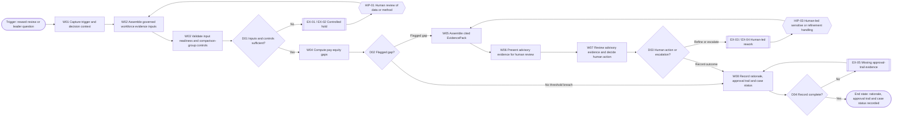
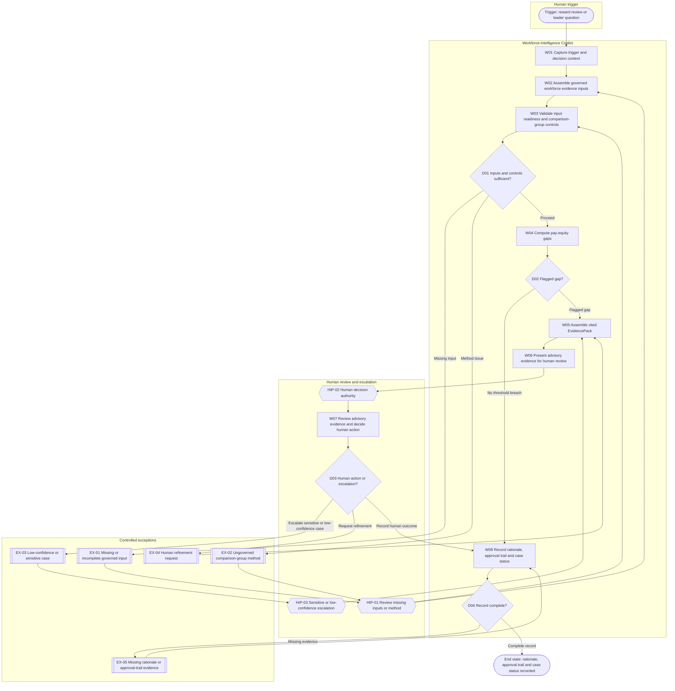

# Workforce-Intelligence Copilot - Stage 3 Decompose Deliverable

## Document Control

| Control Item | Details | Evidence |
| --- | --- | --- |
| Document title | Workforce-Intelligence Copilot - Stage 3 Decompose Deliverable | [SRC-07, Final deliverable requirements] |
| Deliverable filename | `Workforce_Intelluigence_Copilot_Stage3_Decompose.md` | [SRC-07, Repository and output] |
| Business agent ID and name | HR-PTO-002, Workforce-Intelligence Copilot | [SRC-01, section 6.3 Workforce-Intelligence Copilot] |
| Version | Draft v0.1 | [SRC-05, title block] |
| Status | Review-ready with controlled gaps - SME confirmation pending; not Stage 3 complete | [SRC-04, section 11.8 Acceptance gate]; [SRC-07, Validation and status] |
| Prepared by | GitHub Copilot Coding Agent | [SRC-07, Current Stage 3 problem statement for Workforce-Intelligence Copilot] |
| Prepared for | Stage 3 SME review and approval | [SRC-02, Stage 3 activities]; [SRC-05, Document Control] |
| Date | 17 September 2026 | [SRC-07, Current Stage 3 problem statement for Workforce-Intelligence Copilot] |
| Approval required from | Business SME `TBC-01`; Stage 3 Approver `TBC-02` | [SRC-07, Gaps that must be controlled, not invented]; [SRC-04, section 9.1 Frontmatter and controls] |
| Review purpose | Confirm that the Stage 3 decomposition accurately reflects the Workforce-Intelligence Copilot capability, workflow, decisions, handovers, exceptions and human-intervention model without inventing unsupported detail. | [SRC-02, Objective]; [SRC-03, section 12 Workflow decomposition rules]; [SRC-07, Evidence and source controls] |

## Version History

| Version | Date | Author | Summary of change | Status | Evidence |
| --- | --- | --- | --- | --- | --- |
| 0.1 | 17 September 2026 | GitHub Copilot Coding Agent | Initial evidence-based Stage 3 draft with supporting registers and formal validation record. | Draft | [SRC-07, Required artefacts]; [SRC-07, Validation and status] |

## Review and Approval

| Role | Name | Review / Approval | Date | Evidence / Reference |
| --- | --- | --- | --- | --- |
| Business SME | `TBC-01` | Pending SME walkthrough | `TBC-08` | [SRC-07, Gaps that must be controlled, not invented] |
| Technical / Delivery Lead | Owner to be assigned | Pending review | `TBC-03` | [SRC-01, section 6.3 Workforce-Intelligence Copilot] |
| Stage 3 Approver | `TBC-02` | Pending approval | `TBC-09` | [SRC-07, Gaps that must be controlled, not invented]; [SRC-07, Validation and status] |

## Table of Contents

- [Executive Summary](#executive-summary)
- [Stage 3 Activities and Outputs](#stage-3-activities-and-outputs)
- [Step 1 – Review and Understand the Capability](#step-1--review-and-understand-the-capability)
- [Step 2 – Create the Overall AI Framework](#step-2--create-the-overall-ai-framework)
- [Step 3 – Map the End-to-End Workflow](#step-3--map-the-end-to-end-workflow)
- [Step 4 – Decompose into Workflow Steps](#step-4--decompose-into-workflow-steps)
- [Step 5 – Define Handovers and Interactions](#step-5--define-handovers-and-interactions)
- [Decisions, Exceptions and Human Intervention Points](#decisions-exceptions-and-human-intervention-points)
- [Steps 6 and 7 – SME Validation and Confirmation](#steps-6-and-7--sme-validation-and-confirmation)
- [Completion and Quality Checklist](#completion-and-quality-checklist)
- [Appendix A – Glossary and Acronyms](#appendix-a--glossary-and-acronyms)
- [Appendix B – Source and Evidence Register](#appendix-b--source-and-evidence-register)
- [Appendix C – Stage 3 to Stage 4 Handover](#appendix-c--stage-3-to-stage-4-handover)

## Executive Summary

- Workforce-Intelligence Copilot supports the **Optimised Business Partnering** capability within the **Measure to Reward** value stream and is intended to deliver defensible, evidence-based reward and pay-equity compliance together with faster cited advisory. [SRC-01, Part 1 - For HR: agents, outcomes & client value, value stream table]
- The source-supported business purpose is to give business leaders fast, evidence-based workforce recommendations by assembling planning data, policy and analytics into decision-ready packs while HRBPs and leaders stay accountable. [SRC-01, section 3 Measure to Reward - Optimised Business Partnering, Purpose]
- The copilot is advisory only. Deterministic pay-equity computation and evidence-pack aggregation remain machine-performed, but every workforce decision and every low-confidence or sensitive case remains human-led. The autonomy range `L1-L3` is proposed rather than approved and is therefore carried as `TBC-10`. [SRC-01, section 3 Measure to Reward - Optimised Business Partnering, Deterministic calculation requirements]; [SRC-01, section 3 Measure to Reward - Optimised Business Partnering, Human-in-the-loop boundary]; [SRC-01, section 6.3 Workforce-Intelligence Copilot]
- This Stage 3 decomposition derives an end-to-end workflow from the supported trigger, behaviour chain and generic script: reward review or leader question -> assemble governed inputs -> validate comparison-group readiness -> compute pay-equity gaps -> assemble cited EvidencePack -> human review and decision -> record rationale and approval trail. Derived structuring needed for operational completeness is explicitly marked and controlled rather than treated as source fact. [SRC-01, section 3 Measure to Reward - Optimised Business Partnering, Behaviours]; [SRC-01, section 6.3 Workforce-Intelligence Copilot, Generic agent script]; [SRC-07, Evidence and source controls]
- Structural, traceability and governance checks pass for this draft, but SME review, approval evidence, ownership assignments, approved autonomy, operational comparison-group controls, final system/interface detail and several other matters remain open under registered `TBC` and `VAL` items. The document is therefore **review-ready with controlled gaps**, not Stage 3 complete. [SRC-04, section 11.8 Acceptance gate]; [SRC-07, Validation and status]

## Stage 3 Activities and Outputs

| Step | Activity | Capability-specific output / evidence | Evidence |
| --- | --- | --- | --- |
| 1 | Review and understand the capability | Confirmed capability summary, boundary, success-measure register and controlled gap register for Workforce-Intelligence Copilot. | [SRC-02, Stage 3 activities]; [SRC-01, section 3 Measure to Reward - Optimised Business Partnering]; [SRC-07, Gaps that must be controlled, not invented] |
| 2 | Create the Overall AI Framework | Business-process AI framework covering purpose, users, inputs, outputs, human boundaries, governance controls and dependencies. | [SRC-02, Outputs of Stage 3]; [SRC-03, section 6 Expected outputs] |
| 3 | Map the end-to-end workflow | High-level workflow purpose, trigger, end state, sequence table and Mermaid process map with decision and exception paths. | [SRC-02, Stage 3 activities]; [SRC-04, section 9.6 End-to-End Workflow] |
| 4 | Decompose into workflow steps | Detailed workflow catalogue `W01`-`W08` with performers, operations, outputs, controls, exceptions and evidence. | [SRC-04, section 9.7 Workflow Decomposition Catalogue]; [SRC-07, Final deliverable requirements] |
| 5 | Define handovers and interactions | Handover register `H01`-`H05` and dependency register `DEP-01`-`DEP-07`. | [SRC-02, Stage 3 activities]; [SRC-04, section 9.8 Handover and Interaction Register] |
| 6 | Validate with SME | Walkthrough checklist and validation-action log prepared; execution remains pending under `TBC-08`. | [SRC-02, Stage 3 activities]; [SRC-07, Gaps that must be controlled, not invented] |
| 7 | Obtain SME confirmation | Confirmation and approval sections are present, but responses remain pending under `TBC-09`; the draft is not labelled Stage 3 complete. | [SRC-02, Stage 3 activities]; [SRC-04, section 11.8 Acceptance gate]; [SRC-07, Validation and status] |

## Step 1 – Review and Understand the Capability

### Capability Summary

| Area | Definition | Evidence |
| --- | --- | --- |
| Business capability | Optimised Business Partnering | [SRC-01, section 6.3 Workforce-Intelligence Copilot] |
| Business outcome | Defensible, evidence-based reward and pay-equity compliance and faster cited advisory | [SRC-01, Part 1 - For HR: agents, outcomes & client value, value stream table] |
| Business agent name | Workforce-Intelligence Copilot | [SRC-01, section 6.3 Workforce-Intelligence Copilot] |
| Business agent ID | HR-PTO-002 | [SRC-01, section 6.3 Workforce-Intelligence Copilot] |
| Business owner / owner persona | Reward + HRBP; exact split of decision authority versus business leaders remains `TBC-21` | [SRC-01, section 3 Measure to Reward - Optimised Business Partnering, Owner persona]; [SRC-01, section 4.3 Segregation-of-duties matrix]; [SRC-07, Gaps that must be controlled, not invented] |
| Primary user personas | Reward + HRBP are evidenced directly; business leaders are evidenced as recipients of recommendations and holders of accountability | [SRC-01, section 3 Measure to Reward - Optimised Business Partnering, Purpose]; [SRC-01, section 3 Measure to Reward - Optimised Business Partnering, Human-in-the-loop boundary] |
| Autonomy level | `L1-L3` proposed only; approval remains `TBC-10` | [SRC-01, section 6.3 Workforce-Intelligence Copilot]; [SRC-07, Gaps that must be controlled, not invented] |
| Primary purpose | Assemble planning data, policy and analytics into decision-ready packs for evidence-based workforce recommendations while humans remain accountable | [SRC-01, section 3 Measure to Reward - Optimised Business Partnering, Purpose] |
| Trigger | Reward review or leader question | [SRC-01, section 6.3 Workforce-Intelligence Copilot, Generic agent script]; [SRC-07, Pre-generation sufficiency decision] |
| Supported end state | Rationale, approval trail and case status are recorded after human decision or controlled no-threshold-breach handling | [SRC-01, section 3 Measure to Reward - Optimised Business Partnering, Outputs (entities written)]; [SRC-01, section 6.3 Workforce-Intelligence Copilot, Generic agent script]; [SRC-07, Final deliverable requirements] |

### Capability Boundary

| Boundary Type | Definition | Evidence |
| --- | --- | --- |
| In scope | Assembling planning, analytics, cost and policy inputs; deterministic pay-equity calculation; deterministic evidence-pack aggregation; grounded cited narration; human review and recorded rationale or approval trail | [SRC-01, section 3 Measure to Reward - Optimised Business Partnering, Purpose]; [SRC-01, section 3 Measure to Reward - Optimised Business Partnering, Inputs (entities read)]; [SRC-01, section 3 Measure to Reward - Optimised Business Partnering, Outputs (entities written)]; [SRC-01, section 3 Measure to Reward - Optimised Business Partnering, Deterministic calculation requirements] |
| Out of scope | Autonomous pay decisions, autonomous people decisions, autonomous workforce decisions such as organisation design, hiring and restructuring, and Stage 4 technical or agent-classification design | [SRC-01, section 3 Measure to Reward - Optimised Business Partnering, Deterministic calculation requirements]; [SRC-01, section 3 Measure to Reward - Optimised Business Partnering, Human-in-the-loop boundary]; [SRC-03, section 14 Stage boundary]; [SRC-07, Stage boundary] |
| Autonomy boundary | Advisory only; all workforce decisions and low-confidence or sensitive cases escalate to humans; approved operating autonomy remains `TBC-10` | [SRC-01, section 3 Measure to Reward - Optimised Business Partnering, Human-in-the-loop boundary]; [SRC-01, section 6.3 Workforce-Intelligence Copilot]; [SRC-07, Gaps that must be controlled, not invented] |
| Mandatory guardrails | Documented rationale and approval trail; provenance on every figure; no autonomous people decisions; human-led workforce decisions; like-for-like comparison groups; segregation of duties between recommendation and approval | [SRC-01, section 3 Measure to Reward - Optimised Business Partnering, Governance & compliance controls]; [SRC-01, section 3 Measure to Reward - Optimised Business Partnering, Risks]; [SRC-01, section 4.3 Segregation-of-duties matrix]; [SRC-03, section 10 Governance and human-approval rules] |
| Dependencies | Workforce plan and scenarios; people analytics and cost; policy and guidance; HCM compensation / Reward analytics build-next system(s) of record; governed comparison-group methodology; human decision-makers; compliance and retention interpretation; final interfaces and ownership assignments `TBC-04` to `TBC-07`, `TBC-14`, `TBC-18` to `TBC-21` | [SRC-01, section 3 Measure to Reward - Optimised Business Partnering, Inputs (entities read)]; [SRC-01, section 6.3 Workforce-Intelligence Copilot, Systems of record]; [SRC-07, Gaps that must be controlled, not invented] |

### Success Measures

| ID | Measure | Baseline | Target | Method / Evidence | Owner | Evidence |
| --- | --- | --- | --- | --- | --- | --- |
| SM-01 | Pay-gap computation correctness versus a worked reference | TBC-13 | TBC-13 | Worked-reference comparison of deterministic pay-gap outputs | TBC-13 | [SRC-01, section 3 Measure to Reward - Optimised Business Partnering, Evaluation criteria]; [SRC-07, Gaps that must be controlled, not invented] |
| SM-02 | Coverage of comparison groups | TBC-13 | TBC-13 | Measure coverage across the agreed governed comparison-group set | TBC-13 | [SRC-01, section 3 Measure to Reward - Optimised Business Partnering, Evaluation criteria]; [SRC-07, Gaps that must be controlled, not invented] |
| SM-03 | Percentage of decisions supported by an EvidencePack | TBC-13 | TBC-13 | EvidencePack coverage across supported decisions | TBC-13 | [SRC-01, section 3 Measure to Reward - Optimised Business Partnering, Evaluation criteria]; [SRC-07, Gaps that must be controlled, not invented] |
| SM-04 | Grounding and faithfulness of narrative | TBC-13 | TBC-13 | Grounding and faithfulness review of cited narration | TBC-13 | [SRC-01, section 3 Measure to Reward - Optimised Business Partnering, Evaluation criteria]; [SRC-07, Gaps that must be controlled, not invented] |

### Assumptions, Constraints and Open Questions

The full controlled register is maintained in `Assumptions_Constraints_Open_Questions.csv`. The highest-impact Stage 3 items are summarised below.

| ID | Type | Description | Impact | Owner | Resolution action | Status / Due date | Affected sections | Evidence |
| --- | --- | --- | --- | --- | --- | --- | --- | --- |
| ACO-01 | Constraint | The evidence set is sufficient with controlled gaps, so the deliverable may be review-ready with controlled gaps but must not be labelled Stage 3 complete until SME confirmation is evidenced. | Status wording, approvals and completion claims must remain conservative. | Stage 3 Approver (TBC-02) | Retain review-ready status until TBC-08 and TBC-09 are closed through SME review and approval evidence. | Open; due date not evidenced | Document Control; Review and Approval; Steps 6 and 7 – SME Validation and Confirmation; Completion and Quality Checklist; Stage3_Validation_Report.md | [SRC-07, Pre-generation sufficiency decision]; [SRC-04, section 11.8 Acceptance gate] |
| ACO-03 | Constraint | Workforce-Intelligence Copilot remains advisory only: it may assemble evidence, compute deterministic pay-equity outputs and provide grounded narration, but it must not make autonomous pay or workforce decisions. | Every consequential workforce decision and any sensitive or low-confidence case must remain human-led. | Reward + HRBP | Preserve human review, escalation and recording controls across all workflow and catalogue artefacts. | Open; due date not evidenced | Executive Summary; Capability Boundary; Overall AI Framework; Workflow Decomposition Catalogue; Decision Catalogue; Human Intervention Points | [SRC-01, section 3 Measure to Reward - Optimised Business Partnering, Deterministic calculation requirements]; [SRC-01, section 3 Measure to Reward - Optimised Business Partnering, Human-in-the-loop boundary]; [SRC-01, section 4.3 Segregation-of-duties matrix] |
| TBC-08 | Missing information | SME walkthrough evidence and dates are not supplied. | Step 6 validation remains pending and confirmation questions cannot be marked complete. | Business SME (TBC-01) | Complete the walkthrough checklist, capture notes and record dates and any changes. | Open; due date not evidenced | Steps 6 and 7 – SME Validation and Confirmation; Stage3_Validation_Report.md | [SRC-02, Stage 3 activities]; [SRC-07, Gaps that must be controlled, not invented] |
| TBC-10 | Open question | Autonomy level L1–L3 is explicitly proposed rather than approved. | The approved autonomy boundary cannot yet be finalised in Stage 3 records. | Reward + HRBP | Approve and evidence the operating autonomy level for this capability. | Open; due date not evidenced | Capability Summary; Capability Boundary; Overall AI Framework; Appendix C – Stage 3 to Stage 4 Handover | [SRC-01, section 6.3 Workforce-Intelligence Copilot]; [SRC-07, Gaps that must be controlled, not invented] |
| TBC-14 | Open question | The governed comparison-group methodology and controls for role, level and tenure are required but not specified in operational detail. | Like-for-like pay-equity analysis cannot be treated as fully operational without SME-approved methodology and control evidence. | Reward + HRBP | Define and approve the comparison-group methodology, control points and approval evidence. | Open; due date not evidenced | Capability Boundary; Overall AI Framework; Workflow Decomposition Catalogue; Decision Catalogue; Exception Catalogue; Human Intervention Points | [SRC-01, section 3 Measure to Reward - Optimised Business Partnering, Risks]; [SRC-01, section 1 HR Ontology & Knowledge Graph - core entity model] |
| TBC-15 | Open question | Low-confidence and sensitive-question criteria and detailed escalation rules are not evidenced. | Exception and human-intervention logic can show the boundary but not fully operational decision criteria. | Reward + HRBP | Define low-confidence and sensitive-question criteria, evidence requirements and escalation routes. | Open; due date not evidenced | Overall AI Framework; Decision Catalogue; Exception Catalogue; Human Intervention Points; Appendix C – Stage 3 to Stage 4 Handover | [SRC-01, section 3 Measure to Reward - Optimised Business Partnering, Human-in-the-loop boundary]; [SRC-07, Gaps that must be controlled, not invented] |
| TBC-19 | Missing information | Interfaces, channels, frequencies, SLAs and the write-back mechanism are not fully defined; the source states build-next or proposed states only. | Handover and dependency registers cannot specify physical integration or service levels as facts. | Technical owner (TBC-03) | Define channels, frequencies, SLAs and write-back mechanics during later-stage design. | Open; due date not evidenced | Handover and Interaction Register; Interface and Dependency Register; Appendix C – Stage 3 to Stage 4 Handover | [SRC-01, section 6.3 Workforce-Intelligence Copilot, Systems of record]; [SRC-07, Gaps that must be controlled, not invented] |
| TBC-21 | Open question | The distinct business ownership, approval and decision authority split between “Reward + HRBP”, “HRBPs” and “business leaders” is not fully resolved in source evidence. | Human decision and approval tables must preserve the ambiguity rather than collapsing the roles. | Reward + HRBP | Confirm which human roles review, approve, decide and record each decision type. | Open; due date not evidenced | Capability Summary; Overall AI Framework; Handover and Interaction Register; Decision Catalogue; Human Intervention Points; Appendix C – Stage 3 to Stage 4 Handover | [SRC-01, section 3 Measure to Reward - Optimised Business Partnering, Purpose]; [SRC-01, section 3 Measure to Reward - Optimised Business Partnering, Human-in-the-loop boundary]; [SRC-01, section 4.3 Segregation-of-duties matrix]; [SRC-07, Gaps that must be controlled, not invented] |
| TBC-22 | Open question | Additional operational workflow detail needed to make the decomposition fully operational remains unsupported, including handling of no-threshold-breach cases, iterative refinement triggers and close/learn mechanics. | The Stage 3 workflow remains a controlled derived decomposition rather than an operating procedure. | Business SME (TBC-01) | Confirm unsupported operational details during SME walkthrough without inventing them in Stage 3. | Open; due date not evidenced | High-Level Workflow Sequence; Detailed workflow diagram; Workflow Decomposition Catalogue; Exception Catalogue; Appendix C – Stage 3 to Stage 4 Handover | [SRC-01, section 3 Measure to Reward - Optimised Business Partnering, Behaviours]; [SRC-01, section 6.3 Workforce-Intelligence Copilot, Generic agent script]; [SRC-07, Gaps that must be controlled, not invented] |
| TBC-23 | Missing information | Explicit approval metadata is not evidenced for methodology, instruction, skill and template sources that are mandatory for this task. | The Source and Evidence Register must describe approval as not evidenced rather than implying approval from repository location. | Stage 3 Approver (`TBC-02`) | Capture source approval metadata or confirm that approval remains not evidenced for `SRC-02` to `SRC-05`. | Open; due date not evidenced | Appendix B – Source and Evidence Register; Stage3_Validation_Report.md | [SRC-03, section 4 Source approval and evidence rules]; [SRC-07, Evidence and source controls] |

## Step 2 – Create the Overall AI Framework

| Framework Element | Definition | Evidence |
| --- | --- | --- |
| Purpose | Give business leaders fast, evidence-based workforce recommendations by assembling planning data, policy and analytics into decision-ready packs. | [SRC-01, section 3 Measure to Reward - Optimised Business Partnering, Purpose] |
| Intended outcomes | Defensible, evidence-based reward and pay-equity compliance; faster cited advisory; decision-ready evidence packs for human workforce decisions | [SRC-01, Part 1 - For HR: agents, outcomes & client value, value stream table]; [SRC-01, section 3 Measure to Reward - Optimised Business Partnering, Use case] |
| Business owner | Reward + HRBP are the evidenced owner persona; the exact split versus business leaders remains `TBC-21`. | [SRC-01, section 3 Measure to Reward - Optimised Business Partnering, Owner persona]; [SRC-07, Gaps that must be controlled, not invented] |
| Users | Reward + HRBP are the direct owner/users; business leaders receive the recommendations and retain workforce decision accountability. | [SRC-01, section 3 Measure to Reward - Optimised Business Partnering, Purpose]; [SRC-01, section 3 Measure to Reward - Optimised Business Partnering, Human-in-the-loop boundary] |
| Trigger | Reward review or leader question | [SRC-01, section 6.3 Workforce-Intelligence Copilot, Generic agent script]; [SRC-07, Pre-generation sufficiency decision] |
| Inputs | Workforce plan, gaps and scenarios; people analytics and cost; policy and guidance; leader question or decision context | [SRC-01, section 3 Measure to Reward - Optimised Business Partnering, Inputs (entities read)]; [SRC-07, Pre-generation sufficiency decision] |
| Outputs | EvidencePack containing gap, rationale and approval trail; recorded rationale and approval-trail evidence after human decision | [SRC-01, section 3 Measure to Reward - Optimised Business Partnering, Outputs (entities written)]; [SRC-01, section 6.3 Workforce-Intelligence Copilot, Generic agent script] |
| Value delivered | Faster cited advisory plus evidence that supports defensible reward and pay-equity compliance without delegating consequential workforce decisions to the copilot | [SRC-01, Part 1 - For HR: agents, outcomes & client value, value stream table]; [SRC-01, section 3 Measure to Reward - Optimised Business Partnering, Purpose] |
| Systems and dependencies | Logical workforce-planning, analytics, cost and policy sources plus build-next HCM compensation / Reward analytics systems of record; final schema, interfaces, channels and write-back remain `TBC-17` to `TBC-19`. | [SRC-01, section 4.2 Agent registry]; [SRC-01, section 6.3 Workforce-Intelligence Copilot, Data schema]; [SRC-01, section 6.3 Workforce-Intelligence Copilot, Systems of record]; [SRC-07, Gaps that must be controlled, not invented] |
| Human involvement | Humans trigger or receive the advisory flow, review the EvidencePack, make every workforce decision and take over low-confidence or sensitive cases. | [SRC-01, section 3 Measure to Reward - Optimised Business Partnering, Purpose]; [SRC-01, section 3 Measure to Reward - Optimised Business Partnering, Human-in-the-loop boundary] |
| Governance controls | Advisory-only boundary; documented rationale and approval trail; provenance on every figure; no autonomous people decisions; immutable audit content retained per policy; segregation of duties | [SRC-01, section 3 Measure to Reward - Optimised Business Partnering, Governance & compliance controls]; [SRC-01, section 4.3 Segregation-of-duties matrix]; [SRC-01, section 4.4 Audit trail schema] |
| Compliance considerations | UK GDPR; EU AI Act (advisory, non-decisioning); ISO 30414; EU Pay Transparency Directive; client- and jurisdiction-specific applicability and retention remain `TBC-20` | [SRC-01, section 3 Measure to Reward - Optimised Business Partnering, Governance & compliance controls]; [SRC-01, section 4.5 Compliance framework cross-reference]; [SRC-07, Gaps that must be controlled, not invented] |
| Human guardrails | No autonomous pay or people decisions; all workforce decisions and low-confidence or sensitive questions escalate to humans; recommendation is not approval and silence is not approval. | [SRC-01, section 3 Measure to Reward - Optimised Business Partnering, Deterministic calculation requirements]; [SRC-01, section 3 Measure to Reward - Optimised Business Partnering, Human-in-the-loop boundary]; [SRC-03, section 10 Governance and human-approval rules] |
| Known constraints | Build-next status; proposed but unapproved autonomy; unresolved criticality and risk; unresolved ownership assignments; unresolved comparison-group method, interfaces and retention configuration | [SRC-01, section 6.3 Workforce-Intelligence Copilot]; [SRC-07, Gaps that must be controlled, not invented] |

## Step 3 – Map the End-to-End Workflow

### Workflow Purpose and Scope

- Start from the supported business trigger of a reward review or leader question. [SRC-01, section 6.3 Workforce-Intelligence Copilot, Generic agent script]
- Follow the supported behaviour chain **Assemble -> Compute equity -> Evidence -> (human) -> Record** and decompose it into operationally meaningful Stage 3 workflow steps without adding technical design detail. [SRC-01, section 3 Measure to Reward - Optimised Business Partnering, Behaviours]; [SRC-03, section 12 Workflow decomposition rules]
- Preserve exception, rework and human-control paths for missing evidence, unguided comparison groups, low-confidence or sensitive cases, refinement requests and incomplete approval-trail evidence. [SRC-01, section 3 Measure to Reward - Optimised Business Partnering, Human-in-the-loop boundary]; [SRC-01, section 3 Measure to Reward - Optimised Business Partnering, Risks]; [SRC-03, section 12 Workflow decomposition rules]
- Finish at a supported recorded end state in which the rationale, approval trail and case status have been recorded, or the case remains in a controlled hold if mandatory evidence is missing. [SRC-01, section 3 Measure to Reward - Optimised Business Partnering, Outputs (entities written)]; [SRC-01, section 4.4 Audit trail schema]; [SRC-03, section 10 Governance and human-approval rules]

### High-Level Process Map

### High-Level Workflow Sequence

| Sequence | Workflow stage | Purpose | Entry criteria | Exit criteria | Evidence |
| --- | --- | --- | --- | --- | --- |
| 1 | Trigger and context capture | Register the reward review or leader question and the decision context. | Supported trigger exists. | Advisory case record exists. | [SRC-01, section 6.3 Workforce-Intelligence Copilot, Generic agent script] |
| 2 | Governed evidence assembly | Assemble the planning, analytics, cost and policy inputs needed for the advisory case. | Advisory case record exists. | Governed input bundle exists. | [SRC-01, section 3 Measure to Reward - Optimised Business Partnering, Inputs (entities read)] |
| 3 | Readiness and deterministic analysis | Validate input readiness and comparison-group control basis, then compute pay-equity gaps if ready. | Governed input bundle exists. | Deterministic pay-equity result set exists or the case is in controlled hold. | [SRC-01, section 3 Measure to Reward - Optimised Business Partnering, Risks]; [SRC-01, section 3 Measure to Reward - Optimised Business Partnering, Deterministic calculation requirements] |
| 4 | Evidence and human decision | Assemble the EvidencePack and pass it into human review for any flagged or escalated case. | Flagged gap or escalated case exists. | Human decision, refinement or escalation direction exists. | [SRC-01, section 3 Measure to Reward - Optimised Business Partnering, Outputs (entities written)]; [SRC-01, section 3 Measure to Reward - Optimised Business Partnering, Human-in-the-loop boundary] |
| 5 | Recording and controlled end state | Record rationale, approval trail and case status, or hold the case open until missing evidence is completed. | Human outcome or no-threshold-breach result exists. | Recorded end-state evidence exists or the case remains on controlled hold. | [SRC-01, section 4.4 Audit trail schema]; [SRC-03, section 10 Governance and human-approval rules] |

## Step 4 – Decompose into Workflow Steps

The catalogue below is the **derived Stage 3 decomposition** of the source-supported behaviour chain, purpose statement, inputs/outputs, human boundary and generic script. Unsupported operating detail is carried forward only as controlled `TBC` or `VAL` items. [SRC-01, section 3 Measure to Reward - Optimised Business Partnering, Behaviours]; [SRC-01, section 6.3 Workforce-Intelligence Copilot, Generic agent script]; [SRC-07, Evidence and source controls]

### Detailed Workflow Diagram

### Workflow Decomposition Catalogue

| Step | Activity | Description | Producing performer | Consuming performer | Inputs | Operations | Consumed data | Created data | Updated data | Output/evidence | Control/decision | Previous/next | Exceptions | Evidence |
| --- | --- | --- | --- | --- | --- | --- | --- | --- | --- | --- | --- | --- | --- | --- |
| W01 | Capture trigger and decision context | Capture the supported trigger of a reward review or leader question and register the decision context that will govern the advisory cycle. This is a derived Stage 3 decomposition of the supported trigger and purpose statements. | Reward + HRBP or business leader | Workforce-Intelligence Copilot | Reward review event or leader question; decision context | Read, Create, Transmit | Leader question and decision context | Advisory case record and trigger reference | None | Registered advisory case and trigger trace | Advisory-only boundary applies from case creation; all workforce decisions remain human-led. | Start -> W02 | None | [SRC-01, section 3 Measure to Reward - Optimised Business Partnering, Purpose]; [SRC-01, section 6.3 Workforce-Intelligence Copilot, Generic agent script]; [SRC-07, Pre-generation sufficiency decision] |
| W02 | Assemble governed workforce evidence inputs | Assemble the supported inputs required for the advisory cycle: workforce plan, gaps and scenarios; people analytics and cost; policy and guidance; and the leader question or decision context. | Workforce-Intelligence Copilot | Workforce-Intelligence Copilot deterministic core | Advisory case record from W01; workforce plan, gaps and scenarios; people analytics and cost; policy and guidance | Read, Create, Transmit | Workforce planning inputs, analytical inputs, policy inputs and decision context | Governed input bundle and source-data snapshot reference | Advisory case record | Governed input bundle with source trace | Provenance is required on every figure and the output remains a logical, build-next dependency set. | W01 -> W03 | EX-01, EX-02 | [SRC-01, section 3 Measure to Reward - Optimised Business Partnering, Inputs (entities read)]; [SRC-01, section 3 Measure to Reward - Optimised Business Partnering, Governance & compliance controls]; [SRC-01, section 4.4 Audit trail schema] |
| W03 | Validate input readiness and comparison-group controls | Validate whether the governed input bundle is complete enough to proceed and whether the comparison-group approach is like-for-like for role, level and tenure. This readiness gate is a derived control decomposition required by the stated risk and provenance controls. | Workforce-Intelligence Copilot deterministic control layer | Workforce-Intelligence Copilot deterministic core or human reviewer | Governed input bundle and source trace from W02; comparison-group methodology | Read, Validate, Update | Governed input bundle, source-data snapshot and comparison-group methodology | Input-readiness assessment | Advisory case status | Readiness result and any controlled hold or escalation record | D01 | W02 -> W04 | EX-01, EX-02 | [SRC-01, section 3 Measure to Reward - Optimised Business Partnering, Risks]; [SRC-01, section 3 Measure to Reward - Optimised Business Partnering, Governance & compliance controls]; [SRC-07, Gaps that must be controlled, not invented] |
| W04 | Compute pay-equity gaps | Run the deterministic pay-equity computation across comparison groups and create flagged results against the configured threshold. Grounded narration is not used for the numerical computation. | Workforce-Intelligence Copilot deterministic core | Workforce-Intelligence Copilot | Readiness-approved input bundle from W03 | Read, Derive, Create, Update | Comparison-group pay data, controls and threshold context | Pay-equity result set by comparison group | Advisory case status and flagged-group record | Deterministic pay-equity result set and flagged-group trace | D02 | W03 -> W05 or W08 | EX-03 | [SRC-01, section 3 Tool catalogue]; [SRC-01, section 3 Measure to Reward - Optimised Business Partnering, Deterministic calculation requirements]; [SRC-01, section 6.3 Workforce-Intelligence Copilot, Generic agent script] |
| W05 | Assemble cited EvidencePack | Assemble the supported EvidencePack containing the gap, rationale and approval-trail scaffold for any flagged case, using deterministic evidence aggregation and grounded narration only for cited explanation. | Workforce-Intelligence Copilot | Reward + HRBP and relevant business leader | Flagged pay-equity result set from W04; governed input bundle from W02 | Read, Derive, Create, Update, Transmit | Flagged pay-equity results, source trace, policy context and decision context | EvidencePack | Advisory case status | EvidencePack containing gap, rationale and approval-trail scaffold | Narration must remain grounded and cited; no numerical computation or human approval is delegated to the copilot. | W04 -> W06 | EX-03, EX-04 | [SRC-01, section 3 Measure to Reward - Optimised Business Partnering, Outputs (entities written)]; [SRC-01, section 3 Measure to Reward - Optimised Business Partnering, Deterministic calculation requirements]; [SRC-01, section 6.3 Workforce-Intelligence Copilot, Generic agent script] |
| W06 | Present advisory evidence for human review | Surface the EvidencePack and cited advisory output to Reward and the HRBP, and to the relevant business leader where a workforce decision is required. The distinct decision-authority split remains unresolved and is carried as TBC-21. | Workforce-Intelligence Copilot | Reward + HRBP and relevant business leader | EvidencePack from W05 | Read, Transmit, Update | EvidencePack | Human-review request | Advisory case status | Human-review package and transmission trace | D03; recommendation is not approval and segregation of duties must be preserved. | W05 -> W07 | EX-03, EX-04 | [SRC-01, section 3 Measure to Reward - Optimised Business Partnering, Use case]; [SRC-01, section 3 Measure to Reward - Optimised Business Partnering, Human-in-the-loop boundary]; [SRC-01, section 4.3 Segregation-of-duties matrix]; [SRC-07, Gaps that must be controlled, not invented] |
| W07 | Review advisory evidence and decide human action | Reward + HRBP and/or the relevant business leader review the EvidencePack, apply human judgement and determine the human action or escalation outcome. The copilot does not approve its own consequential recommendation. | Reward + HRBP and/or relevant business leader | Workforce-Intelligence Copilot | Human-review package from W06 | Read, Approve, Update, Transmit | EvidencePack, decision context and any escalation rationale | Human decision or escalation record | Advisory case status | Recorded human decision, rationale or escalation direction | D03 | W06 -> W08 | EX-03, EX-04 | [SRC-01, section 3 Measure to Reward - Optimised Business Partnering, Purpose]; [SRC-01, section 3 Measure to Reward - Optimised Business Partnering, Human-in-the-loop boundary]; [SRC-01, section 4.3 Segregation-of-duties matrix]; [SRC-03, section 10 Governance and human-approval rules] |
| W08 | Record rationale, approval trail and case status | Record the resulting rationale, approval trail and case status after the human decision or, where no threshold breach is recorded, the cited advisory outcome. The exact write-back path, retention configuration and close/learn mechanics remain controlled gaps. | Workforce-Intelligence Copilot | Logical approval-trail and case record | Human decision or escalation record from W07, or no-threshold-breach result from D02 | Read, Create, Update, Transmit, Validate | Human decision record, EvidencePack or no-threshold-breach result, source trace and approval-trail requirements | Recorded rationale, approval trail and closure-status record | Advisory case status | Recorded rationale, approval trail, provenance trace and controlled end-state record | D04; missing evidence must hold the case open rather than imply completion. | W04 or W07 -> End | EX-05 | [SRC-01, section 3 Measure to Reward - Optimised Business Partnering, Outputs (entities written)]; [SRC-01, section 3 Measure to Reward - Optimised Business Partnering, Governance & compliance controls]; [SRC-01, section 4.4 Audit trail schema]; [SRC-01, section 6.3 Workforce-Intelligence Copilot, Generic agent script]; [SRC-07, Gaps that must be controlled, not invented] |

## Step 5 – Define Handovers and Interactions

### Handover and Interaction Register

| Handover ID | From | To | Purpose | Data / information | Operations | Producing performer | Consuming performer | Control / SLA | Output / evidence | Evidence |
| --- | --- | --- | --- | --- | --- | --- | --- | --- | --- | --- |
| H01 | Reward + HRBP or business leader | W01 | Initiate the advisory cycle from a supported trigger. | Reward review event or leader question and decision context | Read, Create, Transmit | Reward + HRBP or business leader | Workforce-Intelligence Copilot | Human-triggered entry only; frequency is event-driven and exact cadence remains TBC-19. | Registered trigger reference and advisory case record | [SRC-01, section 3 Measure to Reward - Optimised Business Partnering, Purpose]; [SRC-01, section 6.3 Workforce-Intelligence Copilot, Generic agent script]; [SRC-07, Gaps that must be controlled, not invented] |
| H02 | Logical workforce-planning, analytics, cost and policy sources | W02 | Provide the governed evidence inputs required for pay-equity analysis and advisory assembly. | Workforce plan, gaps and scenarios; people analytics and cost; policy and guidance; source trace | Read, Transmit | Logical source systems and repositories (owners TBC-06) | Workforce-Intelligence Copilot | Provenance on every figure; final interfaces, channels, frequencies and SLAs remain TBC-19. | Governed input bundle and source-data snapshot reference | [SRC-01, section 3 Measure to Reward - Optimised Business Partnering, Inputs (entities read)]; [SRC-01, section 3 Measure to Reward - Optimised Business Partnering, Governance & compliance controls]; [SRC-01, section 4.4 Audit trail schema] |
| H03 | W05 | W06 | Transmit the cited EvidencePack into the human-review boundary. | EvidencePack containing gap, rationale and approval-trail scaffold | Read, Transmit | Workforce-Intelligence Copilot | Reward + HRBP and relevant business leader | Recommendation is advisory only and does not constitute approval. | Human-review package and transmission trace | [SRC-01, section 3 Measure to Reward - Optimised Business Partnering, Outputs (entities written)]; [SRC-01, section 3 Measure to Reward - Optimised Business Partnering, Human-in-the-loop boundary]; [SRC-03, section 10 Governance and human-approval rules] |
| H04 | W07 | W08 | Return the human decision, escalation or refinement direction for recording. | Human decision, rationale, escalation direction or refinement request | Read, Approve, Transmit, Update | Reward + HRBP and/or relevant business leader | Workforce-Intelligence Copilot | Silence or timeout is not approval; exact approval-role split remains TBC-21. | Recorded human decision or escalation instruction | [SRC-01, section 3 Measure to Reward - Optimised Business Partnering, Human-in-the-loop boundary]; [SRC-01, section 4.3 Segregation-of-duties matrix]; [SRC-03, section 10 Governance and human-approval rules]; [SRC-07, Gaps that must be controlled, not invented] |
| H05 | W08 | Logical approval-trail and case record | Persist the rationale, approval trail and case status required by governance controls. | Recorded rationale, approval trail, provenance trace and case status | Create, Update, Transmit, Validate | Workforce-Intelligence Copilot | Logical record of rationale and approval trail (system owner TBC-06) | Immutable audit content retained per policy; exact system, channel and retention configuration remain TBC-18 to TBC-20. | Persisted approval-trail record and retention-control trace | [SRC-01, section 3 Measure to Reward - Optimised Business Partnering, Governance & compliance controls]; [SRC-01, section 4.4 Audit trail schema]; [SRC-01, section 6.3 Workforce-Intelligence Copilot, Systems of record] |

### Interface and Dependency Register

| ID | System / Team | Dependency | Interface / Channel | Availability / Frequency | Owner | Risk / Mitigation | Evidence |
| --- | --- | --- | --- | --- | --- | --- | --- |
| DEP-01 | Workforce-planning process and scenario sources | Provide workforce plan, gaps and scenarios used to scope the advisory case. | TBC-19 (final interface/channel not evidenced) | Event-driven on reward review or leader question; exact cadence TBC-19. | Source-system owner TBC-06 | Incomplete or stale planning inputs can distort advice; W03 readiness validation and EX-01 control the risk. | [SRC-01, section 3 Measure to Reward - Optimised Business Partnering, Inputs (entities read)]; [SRC-07, Gaps that must be controlled, not invented] |
| DEP-02 | People analytics and cost sources | Provide the analytical and cost inputs required for cited advisory and gap computation context. | TBC-19 (final interface/channel not evidenced) | TBC-19 | Data owner TBC-04 / source-system owner TBC-06 | Unclear ownership or stale measures can weaken evidence quality; TBC-04 to TBC-06 and W03 retain the gap explicitly. | [SRC-01, section 3 Measure to Reward - Optimised Business Partnering, Inputs (entities read)]; [SRC-07, Gaps that must be controlled, not invented] |
| DEP-03 | Policy and guidance source | Provide policy and guidance needed to ground cited narration and human decision support. | TBC-19 (final interface/channel not evidenced) | TBC-19 | Control owner TBC-07 / source-system owner TBC-06 | Unversioned policy can undermine evidence; provenance and approval-trail controls must remain explicit. | [SRC-01, section 3 Measure to Reward - Optimised Business Partnering, Inputs (entities read)]; [SRC-01, section 3 Measure to Reward - Optimised Business Partnering, Governance & compliance controls] |
| DEP-04 | Governed comparison-group methodology | Provide like-for-like controls for role, level and tenure before pay-equity comparisons are treated as decision-ready. | Governance artefact or policy reference not yet evidenced (TBC-14) | TBC-14 | Reward + HRBP | Naive comparisons mislead; W03 and D01 hold the workflow until the methodology is adequate. | [SRC-01, section 1 HR Ontology & Knowledge Graph - core entity model]; [SRC-01, section 3 Measure to Reward - Optimised Business Partnering, Risks] |
| DEP-05 | HCM compensation / Reward analytics | Logical system-of-record dependency for reward and compensation evidence, explicitly build-next. | TBC-18/TBC-19 | TBC-19 | Source-system owner TBC-06 | Final system choice and write-back path are unresolved, so Stage 3 keeps the dependency logical only. | [SRC-01, section 6.3 Workforce-Intelligence Copilot, Systems of record]; [SRC-07, Gaps that must be controlled, not invented] |
| DEP-06 | Reward + HRBP and relevant business leader | Human review, approval and decision authority for consequential workforce outcomes. | Human review route; exact routing split TBC-21 | On every workforce decision and on low-confidence or sensitive cases | Reward + HRBP | Collapsing recommendation and approval would break segregation of duties; D03, HIP-02 and HIP-03 preserve the boundary. | [SRC-01, section 3 Measure to Reward - Optimised Business Partnering, Human-in-the-loop boundary]; [SRC-01, section 4.3 Segregation-of-duties matrix] |
| DEP-07 | Compliance and records-retention governance | Provide framework interpretation for UK GDPR, EU AI Act, ISO 30414, EU Pay Transparency Directive and retention controls. | Governance interpretation artefacts not yet evidenced (TBC-20) | TBC-20 | Control owner TBC-07 | Jurisdiction-specific obligations cannot be presumed; retain framework references and carry applicability decisions as controlled gaps. | [SRC-01, section 3 Measure to Reward - Optimised Business Partnering, Governance & compliance controls]; [SRC-01, section 4.4 Audit trail schema]; [SRC-01, section 4.5 Compliance framework cross-reference]; [SRC-07, Gaps that must be controlled, not invented] |

## Decisions, Exceptions and Human Intervention Points

### Decision Catalogue

| Decision ID | Decision question | Performer | Inputs/rules | Outcomes | Affected steps | Evidence produced | Source evidence |
| --- | --- | --- | --- | --- | --- | --- | --- |
| D01 | Are the governed inputs, provenance and comparison-group controls sufficient to proceed? | Workforce-Intelligence Copilot deterministic control layer, with human review under HIP-01 if not sufficient | Governed input bundle; source-data snapshot; provenance-on-every-figure requirement; like-for-like comparison-group control requirement for role, level and tenure | Proceed to W04; hold and complete missing inputs under EX-01; escalate comparison-group governance under EX-02 | W02, W03, W04 | Input-readiness result, hold record or escalation record | [SRC-01, section 3 Measure to Reward - Optimised Business Partnering, Governance & compliance controls]; [SRC-01, section 3 Measure to Reward - Optimised Business Partnering, Risks]; [SRC-07, Gaps that must be controlled, not invented] |
| D02 | Do the deterministic pay-equity results identify a flagged gap against the configured threshold? | Workforce-Intelligence Copilot deterministic core | pay_gap_pct = (avg_group_a - avg_group_b)/avg_group_a; flag if \|gap\| exceeds the configurable threshold (default 5% in source evidence) | Flagged result proceeds to W05 for EvidencePack assembly; no-threshold-breach result proceeds to W08 for cited recording under the controlled-gap closure path | W04, W05, W08 | Deterministic pay-equity result set and flagged-group trace | [SRC-01, section 3 Measure to Reward - Optimised Business Partnering, Use case]; [SRC-01, section 3 Measure to Reward - Optimised Business Partnering, Deterministic calculation requirements]; [SRC-01, section 6.3 Workforce-Intelligence Copilot, Generic agent script] |
| D03 | What human action or escalation outcome is recorded after review of the advisory evidence? | Reward + HRBP and/or relevant business leader (human judgement; exact split TBC-21) | EvidencePack; business context; advisory-only boundary; all workforce decisions are human-led; low-confidence or sensitive questions require escalation | Record a human decision in W08; request refinement under EX-04; escalate a low-confidence or sensitive case under EX-03 | W06, W07, W08 | Human decision, rationale or escalation record with actor and timestamp | [SRC-01, section 3 Measure to Reward - Optimised Business Partnering, Purpose]; [SRC-01, section 3 Measure to Reward - Optimised Business Partnering, Human-in-the-loop boundary]; [SRC-03, section 10 Governance and human-approval rules]; [SRC-07, Gaps that must be controlled, not invented] |
| D04 | Is the resulting rationale, approval trail and case-status evidence complete enough to record or retain the case status? | Workforce-Intelligence Copilot control layer with human remediation if evidence is incomplete | EvidencePack or no-threshold-breach result; human decision record; audit-trail schema; provenance, approval-trail and retention requirements | Persist record in W08; hold open under EX-05 until missing evidence is completed | W08 | Completed record or missing-evidence hold record | [SRC-01, section 3 Measure to Reward - Optimised Business Partnering, Governance & compliance controls]; [SRC-01, section 4.4 Audit trail schema]; [SRC-03, section 10 Governance and human-approval rules] |

### Exception Catalogue

| Exception ID | Class | Trigger | Affected step/decision | Handling | Owner/escalation | Re-entry point | Evidence required | Source evidence |
| --- | --- | --- | --- | --- | --- | --- | --- | --- |
| EX-01 | Missing or incomplete governed input | Required planning, analytics, cost, policy or context inputs are missing, incomplete or unusable at W02/W03. | W02, W03, D01 | Hold the case, record the missing input or provenance gap and route for human-led completion rather than continuing with inferred data. | Reward + HRBP pending named data/control owners TBC-04 and TBC-07 | W02 | Readiness result, missing-input list and remediation note | [SRC-01, section 3 Measure to Reward - Optimised Business Partnering, Inputs (entities read)]; [SRC-01, section 3 Measure to Reward - Optimised Business Partnering, Governance & compliance controls]; [SRC-04, section 10.3 Exception modelling] |
| EX-02 | Ungoverned comparison-group method | The comparison-group approach is not evidenced as like-for-like for role, level and tenure, or the governing method is unresolved. | W03, D01 | Do not proceed to gap computation until the methodology is reviewed and accepted by the human owner. | Reward + HRBP | W03 | Methodology review note, control evidence and decision record | [SRC-01, section 1 HR Ontology & Knowledge Graph - core entity model]; [SRC-01, section 3 Measure to Reward - Optimised Business Partnering, Risks]; [SRC-07, Gaps that must be controlled, not invented] |
| EX-03 | Low-confidence or sensitive case | The case or question falls into the low-confidence or sensitive boundary during W04–W07. | W04, W05, W06, W07, D03 | Escalate to human-led handling and do not allow the copilot to close the consequential decision independently. | Reward + HRBP and/or relevant business leader; criteria and exact escalation rules TBC-15 | W05 or W06 (exact re-entry rule TBC-16) | Escalation record, human-review evidence and resulting direction | [SRC-01, section 3 Measure to Reward - Optimised Business Partnering, Human-in-the-loop boundary]; [SRC-07, Gaps that must be controlled, not invented] |
| EX-04 | Human refinement or alternative analysis request | The human reviewer requests additional evidence, refinement or an alternative analysis outcome at W06/W07. | W05, W06, W07, D03 | Record the request and return the case to the relevant evidence-assembly stage; do not treat the request as approval. | Reward + HRBP and/or relevant business leader | W02 or W05 (exact routing rule TBC-16) | Refinement request, actor, timestamp and revised-case trace | [SRC-01, section 3 Measure to Reward - Optimised Business Partnering, Purpose]; [SRC-03, section 10 Governance and human-approval rules]; [SRC-04, section 10.3 Exception modelling] |
| EX-05 | Missing rationale, approval-trail or retention evidence | The record assembled in W08 lacks required rationale, approval-trail, provenance or retention evidence. | W08, D04 | Hold the case open, capture the deficiency and complete the missing evidence before closure or retention confirmation. | Control owner TBC-07 | W08 | Missing-evidence log and completed approval-trail record | [SRC-01, section 3 Measure to Reward - Optimised Business Partnering, Governance & compliance controls]; [SRC-01, section 4.4 Audit trail schema]; [SRC-03, section 10 Governance and human-approval rules] |

### Human Intervention Points

| HIP ID | Step/decision | Human role | Action/authority | Reason | Segregation requirement | Evidence captured | Outcome/re-entry | Source evidence |
| --- | --- | --- | --- | --- | --- | --- | --- | --- |
| HIP-01 | W03 / D01 | Reward + HRBP, pending named SME and control/data owners | Review missing-input or comparison-group governance issues and authorise whether the case may proceed. | A like-for-like methodology and complete governed inputs are required before any pay-equity result is treated as decision-ready. | The copilot may detect readiness issues but must not self-authorise inadequate inputs or unguided comparison groups. | Readiness review note, decision, actor and timestamp | Proceed to W04 or return to W02/W03 after remediation | [SRC-01, section 3 Measure to Reward - Optimised Business Partnering, Risks]; [SRC-03, section 10 Governance and human-approval rules]; [SRC-07, Gaps that must be controlled, not invented] |
| HIP-02 | W06 / W07 / D03 | Reward + HRBP and/or relevant business leader | Review the EvidencePack, apply human judgement and determine the workforce decision or non-decision outcome. | All workforce decisions remain human-led and the copilot is advisory only. | Recommendation is not approval; the copilot must never approve its own consequential recommendation. | Human decision, rationale, actor, timestamp and approval trail entry | Proceed to W08, request refinement under EX-04 or escalate under EX-03 | [SRC-01, section 3 Measure to Reward - Optimised Business Partnering, Purpose]; [SRC-01, section 3 Measure to Reward - Optimised Business Partnering, Human-in-the-loop boundary]; [SRC-01, section 4.3 Segregation-of-duties matrix] |
| HIP-03 | EX-03 / D03 | Reward + HRBP and/or relevant business leader with further specialist support as required | Take over low-confidence or sensitive cases and decide the appropriate human-led escalation path. | The source explicitly routes low-confidence or sensitive questions to a human-led path. | The copilot may flag the condition but cannot resolve the consequential outcome autonomously. | Escalation record, reviewer identity, timestamp and resulting direction | Return to W05/W06 after direction, or remain in controlled hold until resolved under TBC-16 | [SRC-01, section 3 Measure to Reward - Optimised Business Partnering, Human-in-the-loop boundary]; [SRC-07, Gaps that must be controlled, not invented] |

## Steps 6 and 7 – SME Validation and Confirmation

### SME Walkthrough Checklist

| Validation area | Confirmation question | SME response | Evidence to capture | Action / Owner / Due date | Evidence |
| --- | --- | --- | --- | --- | --- |
| Capability | Does the workflow accurately represent the Workforce-Intelligence Copilot capability? | Pending `TBC-08` | SME walkthrough note | `VAL-02` / Business SME `TBC-01` / due date not evidenced | [SRC-02, Stage 3 activities]; [SRC-04, section 9.12 SME Validation and Confirmation] |
| Workflow completeness | Are all material activities from trigger to recorded end state represented? | Pending `TBC-08` | Accepted workflow or change note | `VAL-02` / Business SME `TBC-01` / due date not evidenced | [SRC-02, Stage 3 activities]; [SRC-04, section 9.12 SME Validation and Confirmation] |
| Granularity | Are the steps at the right Stage 3 level and free from premature technical design? | Pending `TBC-08` | Accepted decomposition catalogue | `VAL-07` / Business SME `TBC-01` / due date not evidenced | [SRC-03, section 12 Workflow decomposition rules]; [SRC-04, section 10.1 Workflow modelling] |
| Decisions and controls | Are comparison-group, escalation and approval decisions represented correctly? | Pending `TBC-08` | Decision review note | `VAL-06` / Reward + HRBP / due date not evidenced | [SRC-01, section 3 Measure to Reward - Optimised Business Partnering, Risks]; [SRC-01, section 4.3 Segregation-of-duties matrix] |
| Exceptions | Are known exception classes, escalation paths and re-entry points sufficient for Stage 3? | Pending `TBC-08` | Exception review note | `VAL-07` / Business SME `TBC-01` / due date not evidenced | [SRC-04, section 10.3 Exception modelling]; [SRC-07, Gaps that must be controlled, not invented] |
| Human intervention | Are all review, approval and escalation boundaries explicit and correctly attributed? | Pending `TBC-08` | HIP review note | `VAL-01` and `VAL-09` / Reward + HRBP / due date not evidenced | [SRC-03, section 10 Governance and human-approval rules]; [SRC-07, Gaps that must be controlled, not invented] |
| Handovers and dependencies | Are all handovers and logical dependencies accurate enough for Stage 4 handover? | Pending `TBC-08` | Handover/dependency review note | `VAL-08` / Technical owner `TBC-03` / due date not evidenced | [SRC-04, section 9.8 Handover and Interaction Register]; [SRC-07, Gaps that must be controlled, not invented] |
| Outcome and status | May this draft be treated as review-ready with controlled gaps but not Stage 3 complete? | Pending `TBC-09` | Approval note | `VAL-03` / Stage 3 Approver `TBC-02` / due date not evidenced | [SRC-04, section 11.8 Acceptance gate]; [SRC-07, Validation and status] |

### Validation Actions and Resolution Log

The full validation-action log is maintained in `Validation_Actions_and_Resolution_Log.csv`.

| ID | Finding / Change | Priority | Owner | Due Date | Resolution | Status | Affected sections | Evidence |
| --- | --- | --- | --- | --- | --- | --- | --- | --- |
| VAL-01 | Confirm the named business SME, Stage 3 approver and all missing owner assignments for technical, data, stewardship, source-system and control roles. | High | Reward + HRBP / Stage 3 Approver (TBC-02) | Due date not evidenced | Open pending closure of TBC-01 to TBC-07. | Open | Review and Approval; Overall AI Framework; Interface and Dependency Register; Human Intervention Points; Appendix C – Stage 3 to Stage 4 Handover | [SRC-07, Gaps that must be controlled, not invented]; [SRC-03, section 8 Ownership terminology] |
| VAL-02 | Complete the SME walkthrough and capture review evidence and dates. | High | Business SME (TBC-01) | Due date not evidenced | Open pending TBC-08. | Open | Steps 6 and 7 – SME Validation and Confirmation; Stage3_Validation_Report.md | [SRC-02, Stage 3 activities]; [SRC-07, Gaps that must be controlled, not invented] |
| VAL-03 | Capture formal approval evidence and dates after walkthrough actions are resolved. | High | Stage 3 Approver (TBC-02) | Due date not evidenced | Open pending TBC-09. | Open | Review and Approval; Steps 6 and 7 – SME Validation and Confirmation; Completion and Quality Checklist | [SRC-04, section 12 Completion response]; [SRC-07, Validation and status] |
| VAL-04 | Approve the operating autonomy level and confirm criticality and risk classifications. | High | Reward + HRBP | Due date not evidenced | Open pending TBC-10 to TBC-12. | Open | Capability Summary; Capability Boundary; Overall AI Framework; Appendix C – Stage 3 to Stage 4 Handover | [SRC-01, section 6.3 Workforce-Intelligence Copilot]; [SRC-07, Gaps that must be controlled, not invented] |
| VAL-05 | Define success-measure baselines, targets, methods and accountable measurement owners. | High | Reward + HRBP | Due date not evidenced | Open pending TBC-13. | Open | Success Measures; Overall AI Framework; Appendix C – Stage 3 to Stage 4 Handover | [SRC-01, section 3 Measure to Reward - Optimised Business Partnering, Evaluation criteria]; [SRC-07, Gaps that must be controlled, not invented] |
| VAL-06 | Approve the governed comparison-group method and low-confidence or sensitive-case criteria. | High | Reward + HRBP | Due date not evidenced | Open pending TBC-14 and TBC-15. | Open | Workflow Decomposition Catalogue; Decision Catalogue; Exception Catalogue; Human Intervention Points | [SRC-01, section 3 Measure to Reward - Optimised Business Partnering, Risks]; [SRC-01, section 3 Measure to Reward - Optimised Business Partnering, Human-in-the-loop boundary]; [SRC-07, Gaps that must be controlled, not invented] |
| VAL-07 | Complete detailed exception, escalation and re-entry rules for operational use. | Medium | Business SME (TBC-01) | Due date not evidenced | Open pending TBC-16 and TBC-22. | Open | Detailed workflow diagram; Workflow Decomposition Catalogue; Exception Catalogue; Human Intervention Points | [SRC-04, section 10.3 Exception modelling]; [SRC-07, Gaps that must be controlled, not invented] |
| VAL-08 | Define the final canonical schema, systems of record, interfaces, channels, frequency, SLAs and write-back mechanism. | Medium | Technical owner (TBC-03) | Due date not evidenced | Open pending TBC-17 to TBC-19. | Open | Overall AI Framework; Handover and Interaction Register; Interface and Dependency Register; Appendix C – Stage 3 to Stage 4 Handover | [SRC-01, section 6.3 Workforce-Intelligence Copilot, Data schema]; [SRC-01, section 6.3 Workforce-Intelligence Copilot, Systems of record]; [SRC-07, Gaps that must be controlled, not invented] |
| VAL-09 | Confirm client/jurisdiction applicability, records-retention obligations and the distinct human authority split between Reward + HRBP, HRBPs and business leaders. | High | Control owner (TBC-07) / Reward + HRBP | Due date not evidenced | Open pending TBC-20 and TBC-21. | Open | Overall AI Framework; Decision Catalogue; Human Intervention Points; Appendix C – Stage 3 to Stage 4 Handover | [SRC-01, section 4.4 Audit trail schema]; [SRC-01, section 4.5 Compliance framework cross-reference]; [SRC-07, Gaps that must be controlled, not invented] |
| VAL-10 | Confirm or explicitly record the approval status of mandatory methodology, instruction, skill and template sources. | Medium | Stage 3 Approver (TBC-02) | Due date not evidenced | Open pending TBC-23. | Open | Appendix B – Source and Evidence Register; Stage3_Validation_Report.md | [SRC-03, section 4 Source approval and evidence rules]; [SRC-07, Evidence and source controls] |

### Confirmation Status

| Confirmation statement | Response | Evidence |
| --- | --- | --- |
| The workflow accurately represents the business process. | Pending SME confirmation under `TBC-08`. | [SRC-04, section 9.12 SME Validation and Confirmation]; [SRC-07, Validation and status] |
| The decomposition is complete and at the correct granularity. | Pending SME confirmation under `TBC-08`; operational-detail gap `TBC-22` remains registered. | [SRC-04, section 9.12 SME Validation and Confirmation]; [SRC-07, Gaps that must be controlled, not invented] |
| The decisions, exceptions, handovers and human intervention points are correct. | Pending SME confirmation under `TBC-08`. | [SRC-04, section 9.12 SME Validation and Confirmation] |
| Stage 3 may proceed to the next stage. | Review-ready with controlled gaps only; not Stage 3 complete until `TBC-09` is closed. | [SRC-04, section 11.8 Acceptance gate]; [SRC-07, Validation and status] |

### Approval Evidence Table

| Role | Name | Signature / Approval evidence | Date | Evidence |
| --- | --- | --- | --- | --- |
| Business SME | `TBC-01` | Pending `TBC-08` | `TBC-08` | [SRC-07, Gaps that must be controlled, not invented] |
| Capability owner | Reward + HRBP | Pending `TBC-09` and ownership-split clarification `TBC-21` | `TBC-09` | [SRC-01, section 3 Measure to Reward - Optimised Business Partnering, Owner persona]; [SRC-07, Gaps that must be controlled, not invented] |
| Stage 3 Approver | `TBC-02` | Pending `TBC-09` | `TBC-09` | [SRC-07, Gaps that must be controlled, not invented]; [SRC-07, Validation and status] |

## Completion and Quality Checklist

| Check | Acceptance criterion | Status | Evidence / Comment |
| --- | --- | --- | --- |
| Required structure present | YAML frontmatter, all required sections and appendices appear in the mandated order. | Pass | Verified against `Stage3_Validation_Report.md`. [SRC-03, section 13 Required document structure]; [SRC-04, section 11.1 Required headings and appendix order] |
| Evidence traceability present | Every factual row includes precise citations and all sources exist in the register. | Pass | Verified in formal validation and source register. [SRC-03, section 4 Source approval and evidence rules]; [SRC-04, section 11.5 Evidence and gap integrity] |
| Identifier integrity preserved | `W`, `D`, `EX`, `HIP`, `H`, `DEP`, `ACO`, `VAL`, `SRC` and `TBC` identifiers are unique and sequential. | Pass | Verified in formal validation and supporting CSVs. [SRC-03, section 7 Naming and identifier conventions]; [SRC-04, section 11.3 Identifier uniqueness and cross-references] |
| Governance boundaries explicit | Advisory-only boundary, provenance, approval trail, segregation of duties and human escalation are explicit. | Pass | Reflected in workflow, decisions, exceptions and HIPs. [SRC-01, section 3 Measure to Reward - Optimised Business Partnering, Governance & compliance controls]; [SRC-03, section 10 Governance and human-approval rules] |
| No unsupported technical design | Content remains business-process focused and defers later-stage design to Appendix C. | Pass | Appendix C carries unresolved later-stage items only. [SRC-03, section 14 Stage boundary]; [SRC-07, Stage boundary] |
| SME walkthrough completed | Walkthrough evidence and dates captured. | Open | Pending `TBC-08` / `VAL-02`. [SRC-02, Stage 3 activities]; [SRC-07, Gaps that must be controlled, not invented] |
| Approval evidence captured | Named approver and approval evidence recorded. | Open | Pending `TBC-09` / `VAL-03`. [SRC-04, section 12 Completion response]; [SRC-07, Validation and status] |
| Operational gaps controlled | All unresolved ownership, methodology, system, compliance and workflow-detail gaps are registered with owners and actions. | Pass | Controlled through `Assumptions_Constraints_Open_Questions.csv` and `Validation_Actions_and_Resolution_Log.csv`. [SRC-07, Gaps that must be controlled, not invented]; [SRC-04, section 11.8 Acceptance gate] |
| Overall status | Review-ready with controlled gaps; not Stage 3 complete. | Pass | Structural and integrity checks pass; SME confirmation remains pending. [SRC-04, section 11.8 Acceptance gate]; [SRC-07, Validation and status] |

## Appendix A – Glossary and Acronyms

| Term / Acronym | Definition | Evidence |
| --- | --- | --- |
| AI | Artificial intelligence | [SRC-05, Appendix A - Glossary and Acronyms] |
| EvidencePack | Evidence artefact containing the pay-equity gap, rationale and approval trail for the supported advisory case | [SRC-01, section 3 Measure to Reward - Optimised Business Partnering, Outputs (entities written)] |
| HRBP | Human Resources Business Partner | [SRC-01, section 3 Measure to Reward - Optimised Business Partnering, Owner persona] |
| ISO 30414 | Workforce-analytics / human-capital reporting framework cited for the reward use case | [SRC-01, section 3 Measure to Reward - Optimised Business Partnering, Governance & compliance controls]; [SRC-01, section 4.5 Compliance framework cross-reference] |
| EU AI Act | European Union AI legislation referenced for advisory, non-decisioning and human-oversight controls | [SRC-01, section 3 Measure to Reward - Optimised Business Partnering, Governance & compliance controls]; [SRC-01, section 4.5 Compliance framework cross-reference] |
| UK GDPR | United Kingdom General Data Protection Regulation referenced for worker-data handling | [SRC-01, section 3 Measure to Reward - Optimised Business Partnering, Governance & compliance controls]; [SRC-01, section 4.5 Compliance framework cross-reference] |
| Comparison group | RewardGroup-style comparator set for pay-equity analysis; exact governance and controls remain `TBC-14` | [SRC-01, section 1 HR Ontology & Knowledge Graph - core entity model]; [SRC-01, section 3 Measure to Reward - Optimised Business Partnering, Risks] |

## Appendix B – Source and Evidence Register

| Source ID | Title | Location | Type | Version/date | Approval status | Approval evidence | Intended use | Evidence |
| --- | --- | --- | --- | --- | --- | --- | --- | --- |
| SRC-01 | HR Capability & Full Agent Catalogue: Engineering Specification | Reference/HR_Capability_and_Full_Agent_Catalogue_v1.md | Approved Stage 2 output / capability evidence | Version/date not stated | Approved | The current task instruction explicitly designates this file as the approved Stage 2 output and authoritative capability evidence. | Primary capability facts, workflow evidence, controls, risks, evaluation criteria, per-agent detail and build-next gaps. | [SRC-07, Mandatory sources and precedence]; [SRC-07, Pre-generation sufficiency decision] |
| SRC-02 | Stage 3 – Decompose | DeliveryControl/Stage_3.md | Methodology | Version/date not stated | Not evidenced (`TBC-23`) | The file is identified as authoritative Stage 3 methodology, but no explicit approval record is present in the repository file; approval metadata remains controlled under `TBC-23`. | Stage objective, inputs, seven activities, outputs, practitioner guidance and next-stage boundary. | [SRC-02, Objective]; [SRC-02, Stage 3 activities]; [SRC-02, Outputs of Stage 3] |
| SRC-03 | HR v2 Stage 3 – Decompose Instructions | Script/Stage 3/Instructions/HRv2_Stage3_Instructions.md | Instruction set | Version/date not stated | Not evidenced (`TBC-23`) | The file is mandatory for this task, but no explicit approval record is present in the repository file; approval metadata remains controlled under `TBC-23`. | Source precedence, evidence rules, identifier rules, governance rules, required document order and acceptance gates. | [SRC-03, section 3 Authoritative sources and precedence]; [SRC-03, section 4 Source approval and evidence rules]; [SRC-03, section 15 Quality and acceptance gates] |
| SRC-04 | HR v2 Stage 3 – Decompose Skill | Script/Stage 3/Skills/HRv2_Stage3_Skills.md | Generation and validation skill | Version/date not stated | Not evidenced (`TBC-23`) | The file is mandatory for this task, but no explicit approval record is present in the repository file; approval metadata remains controlled under `TBC-23`. | Normalised evidence model, mandated CSV columns, document-generation workflow and formal validation checklist. | [SRC-04, section 7 Normalised evidence model]; [SRC-04, section 9 Document-generation workflow]; [SRC-04, section 11 Formal validation checklist] |
| SRC-05 | Stage 3 Decompose Deliverable Template | DocumentTemplate/Stage3/Stage_3_Decompose_Deliverable_Template.md | Template | Draft v0.1 in template body | Not evidenced (`TBC-23`) | The file is required as the structural template, but no explicit approval record is present in the repository file; approval metadata remains controlled under `TBC-23`. | Document-control framing, baseline section scaffolding and appendix expectations, adjusted where higher-priority instructions require more detail. | [SRC-05, title block]; [SRC-05, Document Control]; [SRC-05, section headings] |
| SRC-06 | Payroll Assurance Agent Stage 3 Decompose | Reference/PAA-Deliverables/Stage3/Payroll_Assurance_Agent_Stage_3_Decompose.md | Structure/style/depth reference | Version/date not stated | Approved for structure-only use | The current task instruction explicitly authorises this file for structure, style and depth reference only and forbids reusing Payroll capability facts. | Structure/style/depth reference only; not used as Workforce-Intelligence capability evidence. | [SRC-07, Mandatory sources and precedence] |
| SRC-07 | Current Stage 3 problem statement for Workforce-Intelligence Copilot | Current conversation / task instruction | User instruction | 17 September 2026 | Approved | Active task instruction in the current session. | Output path and filenames, mandatory unresolved-gap coverage, sufficiency status, final-deliverable constraints and validation-status wording. | [SRC-07, Repository and output]; [SRC-07, Mandatory sources and precedence]; [SRC-07, Validation and status] |

## Appendix C – Stage 3 to Stage 4 Handover

| Handover item | Stage 3 output | Intended Stage 4 use | Owner | Status | Evidence |
| --- | --- | --- | --- | --- | --- |
| Overall AI Framework | Business-process purpose, users, inputs, outputs, controls and guardrails | Inform Stage 4 classification without selecting models, prompts or architecture | Reward + HRBP / Technical owner `TBC-03` | Ready with controlled gaps | [SRC-03, section 14 Stage boundary]; [SRC-04, section 9.13 Stage 3 to Stage 4 Handover] |
| Workflow Decomposition Catalogue | `W01`-`W08` workflow catalogue | Classify each step and preserve deterministic-versus-human boundaries | Technical owner `TBC-03` | Ready with controlled gaps | [SRC-04, section 7.2 Workflow-step record]; [SRC-07, Final deliverable requirements] |
| Decision Catalogue | `D01`-`D04` decision model | Inform control design and human-approval design in later stages | Reward + HRBP | Ready with controlled gaps | [SRC-04, section 7.3 Decision record] |
| Exception Catalogue | `EX-01`-`EX-05` controlled exception set | Inform escalation and re-entry design once `TBC-15` and `TBC-16` are resolved | Business SME `TBC-01` | Ready with controlled gaps | [SRC-04, section 7.4 Exception record]; [SRC-07, Gaps that must be controlled, not invented] |
| Human Intervention Points | `HIP-01`-`HIP-03` human-control model | Preserve segregation of duties and human-led decision points in downstream design | Reward + HRBP | Ready with controlled gaps | [SRC-03, section 10 Governance and human-approval rules]; [SRC-04, section 7.6 Human-intervention record] |
| Handover and dependency registers | `H01`-`H05` and `DEP-01`-`DEP-07` | Inform later interface and operating-model discovery without asserting unsupported implementation details | Technical owner `TBC-03` / source-system owner `TBC-06` | Ready with controlled gaps | [SRC-04, section 7.5 Handover record]; [SRC-07, Gaps that must be controlled, not invented] |
| Open gaps and validations | `ACO-01`-`ACO-05`, `TBC-01`-`TBC-23`, `VAL-01`-`VAL-10` | Close blocking evidence, ownership and governance gaps before Stage 4 decisions are finalised | Stage 3 Approver `TBC-02` | Open | [SRC-04, section 7.8 Gap record]; [SRC-04, section 12 Completion response]; [SRC-07, Gaps that must be controlled, not invented] |
| Formal validation record | `Stage3_Validation_Report.md` | Provide the Stage 3 integrity baseline for SME review and downstream work | Stage 3 Approver `TBC-02` | Complete for structural validation; pending SME evidence | [SRC-04, section 11 Formal validation checklist]; [SRC-07, Validation and status] |
