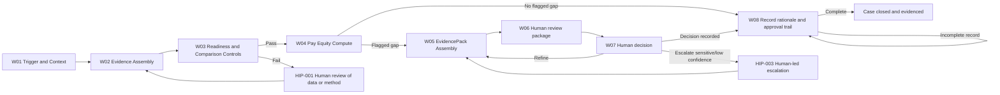
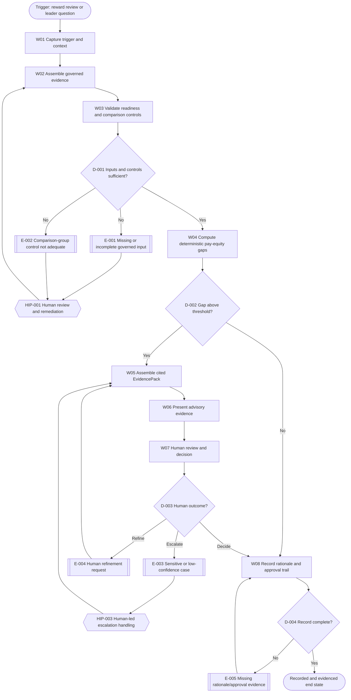

# Executive Summary

This deliverable classifies the Workforce-Intelligence Copilot capability into a controlled Stage 4 logical agent architecture for Optimised Business Partnering within the Measure to Reward value stream. The structure follows Stage 4 methodology requirements for agent inventory, classification, orchestration, handovers, control points, component frameworks, and ABBA reuse assessment. [SRC-01, Objective; SRC-01, Outputs of Stage 4]

Scope is anchored to the Stage 3 decomposition workflow W01-W08 and retains all established constraints: advisory-only operation, deterministic pay-equity calculation, human-led consequential decisions, and full rationale plus approval-trail recording. [SRC-02, Step 4 - Decompose into Workflow Steps; SRC-03, Deterministic calculation requirements; SRC-03, Human-in-the-loop boundary]

Stage 4 summary outcomes:

- Total workflow steps classified: 8 (W01-W08). [SRC-02, Workflow Decomposition Catalogue]
- Total component agents defined: 8 (A-001 to A-008).
- Classification mix across approved types:
  - Task: 4 agents
  - Insight: 2 agents
  - Orchestration: 1 agent
  - Control: 2 agents
  - Experience: 1 agent
- Control coverage: 8 of 8 workflow steps have explicit control points. [SRC-01, activity 6]
- Human intervention points modelled: 3 (HIP-001 to HIP-003). [SRC-02, Human Intervention Points]
- ABBA candidate assets reviewed: 12 relevant candidates; 8 Adapted, 2 Combined, 2 No suitable asset/New design. [SRC-04, relevant rows]

Principal controlled gaps remain in owner-role resolution, approved autonomy boundary confirmation, and final system-interface detail inherited from Stage 3. These are explicitly tracked and do not block logical Stage 4 classification readiness. [SRC-02, Assumptions, Constraints and Open Questions]

# Overall AI Framework

## 1. Logical Agent Landscape

The Workforce-Intelligence Copilot Stage 4 model is decomposed into eight internal component agents that collectively execute the Stage 3 business flow while maintaining deterministic calculation boundaries and human oversight.

| Agent ID | Agent Name | Primary Type | Secondary Type | Core Purpose | Related Steps | Evidence |
| --- | --- | --- | --- | --- | --- | --- |
| A-001 | Trigger and Context Capture Agent | Task | Experience | Capture reward-review or leader-question trigger and establish case context. | W01 | [SRC-02, W01]; [SRC-03, Generic agent script] |
| A-002 | Workforce Evidence Assembly Agent | Task | Insight | Assemble planning, analytics, cost, and policy inputs into governed bundles. | W02 | [SRC-02, W02]; [SRC-03, Inputs (entities read)] |
| A-003 | Input Readiness and Comparison Control Agent | Control | Task | Validate data completeness, provenance, and like-for-like comparison controls. | W03 | [SRC-02, W03]; [SRC-03, Risks] |
| A-004 | Pay Equity Computation Agent | Task | Insight | Run deterministic pay-equity computation and threshold flagging. | W04 | [SRC-02, W04]; [SRC-03, Deterministic calculation requirements] |
| A-005 | Evidence Pack Assembly Agent | Insight | Task | Build cited EvidencePack with rationale and approval-trail scaffold. | W05 | [SRC-02, W05]; [SRC-03, Outputs (entities written)] |
| A-006 | Workforce Intelligence Orchestrator Agent | Orchestration | Control | Orchestrate step sequencing, routing, and escalation between component agents and humans. | W01-W08 | [SRC-01, activity 4]; [SRC-02, end-to-end workflow] |
| A-007 | Human Review and Decision Experience Agent | Experience | Orchestration | Present decision-ready advisory artefacts for human review, decision, and refinement loops. | W06-W07 | [SRC-02, W06-W07]; [SRC-03, Human-in-the-loop boundary] |
| A-008 | Rationale and Approval Trail Control Agent | Control | Task | Persist rationale, approvals, provenance, and case closure state with audit integrity checks. | W08 | [SRC-02, W08]; [SRC-03, Governance & compliance controls] |

## 2. Internal Orchestration Model

Orchestration principles:

- Deterministic core computes figures; grounded narration only explains with citations. [SRC-03, Design principle - deterministic core / LLM boundary]
- No autonomous pay or workforce decisions; all consequential outcomes are human-led. [SRC-03, Deterministic calculation requirements; SRC-03, Human-in-the-loop boundary]
- Every transition has an explicit control owner or control mechanism. [SRC-01, activity 6]

## 3. Stage 4 Deliverables Coverage Matrix

| Stage 4 mandatory output | Coverage section in this document | Status | Evidence |
| --- | --- | --- | --- |
| Agent inventory per workflow step | Workflow Decomposition Catalogue | Complete | [SRC-01, Outputs of Stage 4] |
| Agent classifications | Workflow Decomposition Catalogue; Appendix A | Complete | [SRC-01, activity 3] |
| Internal orchestration diagrams | Overall AI Framework; End-to-End Workflow | Complete | [SRC-01, activity 4] |
| Handovers to previous and next steps | Handover and Interaction Register | Complete | [SRC-01, activity 5] |
| Control point for every step | Workflow Decomposition Catalogue; Control coverage check | Complete | [SRC-01, activity 6] |
| Framework for every agent | Appendix B - Component AI Frameworks | Complete | [SRC-01, activity 7] |
| ABBA reuse and variance log | Appendix C - ABBA Reuse and Variance Log | Complete | [SRC-01, activity 8] |

# End-to-End Workflow

## Workflow Objective

Classify and control the business-operating process that starts at reward review or leader question and ends with a recorded, auditable rationale and approval trail, with deterministic pay-equity analysis and human-led consequential decisions. [SRC-03, Purpose; SRC-03, Generic agent script]

## End-to-End Workflow Diagram

# Workflow Decomposition Catalogue

| Workflow Step ID | Step Name | Step Objective | Operation | Producing Performer | Consuming Performer | Inputs | Outputs | Candidate / Assigned Agent(s) | Agent Type(s) | Control Point ID | Control Type | Evidence |
| --- | --- | --- | --- | --- | --- | --- | --- | --- | --- | --- | --- | --- |
| W-001 | Capture trigger and decision context | Register case trigger and business decision context for processing. | Create, Read, Transmit | Reward + HRBP or business leader | Workforce-Intelligence Copilot | Reward review or leader question | Case initiation context | A-001, A-006 | Task, Orchestration | C-001 | Embedded control | [SRC-02, W01]; [SRC-03, Generic agent script] |
| W-002 | Assemble governed workforce evidence | Collect planning, analytics, cost, and policy evidence into a governed bundle. | Read, Create, Transmit | A-006 | A-002 | Case context; source datasets | Governed evidence bundle | A-002, A-006 | Task, Insight, Orchestration | C-002 | Deterministic rule | [SRC-02, W02]; [SRC-03, Inputs (entities read)] |
| W-003 | Validate readiness and comparison controls | Validate completeness, provenance, and like-for-like comparator governance. | Validate, Read, Update | A-002 | A-003, A-006 | Governed evidence bundle | Readiness and control status | A-003, A-006 | Control, Task, Orchestration | C-003 | Control Agent | [SRC-02, W03]; [SRC-03, Risks] |
| W-004 | Compute pay-equity gaps | Execute deterministic pay-equity calculations and threshold flagging. | Derive, Read, Update | A-003 | A-004 | Approved input bundle | Pay-equity result set and flags | A-004, A-006 | Task, Insight, Orchestration | C-004 | Deterministic rule | [SRC-02, W04]; [SRC-03, Deterministic calculation requirements] |
| W-005 | Assemble cited EvidencePack | Produce decision-ready, cited pack with rationale and approval scaffold. | Derive, Create, Update, Transmit | A-004 | A-005 | Flagged pay-equity result set | EvidencePack | A-005, A-006 | Insight, Task, Orchestration | C-005 | Embedded control | [SRC-02, W05]; [SRC-03, Outputs (entities written)] |
| W-006 | Present advisory evidence for human review | Deliver advisory package to human reviewers with explicit non-approval boundary. | Transmit, Read, Update | A-005 | A-007 | EvidencePack | Human review package | A-007, A-006 | Experience, Orchestration | C-006 | Human review | [SRC-02, W06]; [SRC-03, Human-in-the-loop boundary] |
| W-007 | Human review and decision | Apply human judgement and select decision, refinement, or escalation path. | Approve, Update, Transmit | Reward + HRBP and/or business leader | A-007, A-006 | Human review package | Decision or escalation direction | A-007, A-006 | Experience, Orchestration | C-007 | Human approval | [SRC-02, W07]; [SRC-03, Human-in-the-loop boundary] |
| W-008 | Record rationale, approval trail, and case status | Persist final rationale and approvals with auditable trace and closure state. | Create, Update, Validate, Transmit | A-007 | A-008 | Human decision outcome or no-threshold result | Case record with rationale and approval trail | A-008, A-006 | Control, Task, Orchestration | C-008 | Audit check | [SRC-02, W08]; [SRC-03, Governance & compliance controls]; [SRC-03, 4.4 Audit trail schema] |

## Control Coverage Check

| Check | Result | Evidence |
| --- | --- | --- |
| Every workflow step has one or more control points | Pass (8/8) | [SRC-01, activity 6]; Workflow Decomposition Catalogue |
| Control types are explicit and within allowed classes | Pass | [SRC-01, activity 6] |
| Human review/approval points are explicit | Pass | [SRC-01, activity 2]; [SRC-02, Human Intervention Points] |

# Handover and Interaction Register

| Handover ID | Source Step/Agent | Destination Step/Agent | Information / Artefact Transferred | Producing Performer | Consuming Performer | Control Owner | Preconditions | Postconditions | Failure Mode | Evidence |
| --- | --- | --- | --- | --- | --- | --- | --- | --- | --- | --- |
| H-001 | W-001 / A-001 | W-002 / A-002 | Trigger context and case metadata | Reward + HRBP or business leader | A-002 | A-006 owner (TBC) | Trigger captured | Evidence assembly can begin | Missing context data | [SRC-02, H01]; [SRC-03, Generic agent script] |
| H-002 | W-002 / A-002 | W-003 / A-003 | Governed evidence bundle with provenance links | A-002 | A-003 | Control owner TBC | Input sources available | Readiness check executable | Missing/invalid source artefacts | [SRC-02, H02]; [SRC-03, Governance & compliance controls] |
| H-003 | W-003 / A-003 | W-004 / A-004 | Readiness pass and comparator-control approval | A-003 | A-004 | A-003 | Data and control pass | Deterministic compute permitted | Comparator controls not adequate | [SRC-02, D01]; [SRC-03, Risks] |
| H-004 | W-004 / A-004 | W-005 / A-005 | Flagged gap results with threshold metadata | A-004 | A-005 | A-006 | Gap exceeds threshold | EvidencePack assembly initiated | Incorrect or stale threshold config | [SRC-02, D02]; [SRC-03, Deterministic calculation requirements] |
| H-005 | W-005 / A-005 | W-006 / A-007 | Cited EvidencePack and rationale scaffold | A-005 | Reward + HRBP / business leader via A-007 | Human approver role | EvidencePack complete | Human review starts | Citation completeness issue | [SRC-02, H03]; [SRC-03, Outputs (entities written)] |
| H-006 | W-006/W-007 / A-007 | W-008 / A-008 | Human decision, rationale, approvals, escalation notes | Human reviewers | A-008 | Control owner TBC | Human decision recorded | Audit-trail persistence starts | Missing approval metadata | [SRC-02, H04]; [SRC-03, 4.4 Audit trail schema] |
| H-007 | W-008 / A-008 | Case closure state | Recorded rationale, approval trail, and status | A-008 | Logical system of record (TBC) | Control owner TBC | Record completeness checks pass | Case closed and evidenced | Incomplete rationale or trail | [SRC-02, H05]; [SRC-03, Systems of record] |

# Decision Catalogue

| Decision ID | Decision Name | Triggering Step | Decision Question | Decision Logic / Criteria | Decision Owner | Approval Requirement | Possible Outcomes | Downstream Impact | Evidence |
| --- | --- | --- | --- | --- | --- | --- | --- | --- | --- |
| D-001 | Input and control sufficiency decision | W-003 | Are inputs complete and comparator controls governed? | Data completeness + provenance + like-for-like controls | A-003 + human reviewer if fail | Human review if fail | Pass / Hold / Escalate | Controls whether W-004 may execute | [SRC-02, D01]; [SRC-03, Risks] |
| D-002 | Threshold breach decision | W-004 | Does deterministic gap exceed configured threshold? | pay_gap_pct and threshold comparison | A-004 | None for calculation; human required for consequential action | Breach / No breach | Breach routes to W-005; no breach routes to W-008 | [SRC-02, D02]; [SRC-03, Deterministic calculation requirements] |
| D-003 | Human decision routing | W-007 | What action is taken after advisory review? | Human judgement over cited evidence | Reward + HRBP and/or business leader | Mandatory human decision for consequential outcomes | Decide / Refine / Escalate | Drives closure or loopback | [SRC-02, D03]; [SRC-03, Human-in-the-loop boundary] |
| D-004 | Record completeness decision | W-008 | Is rationale and approval-trail evidence complete? | Audit-trail completeness controls | A-008 + control owner | Human remediation where incomplete | Complete / Incomplete | Complete closes case; incomplete rework to W-008 | [SRC-02, D04]; [SRC-03, 4.4 Audit trail schema] |

# Exception Catalogue

| Exception ID | Exception Name | Trigger Condition | Affected Step(s) | Severity | Containment Action | Escalation Route | Resolution Owner | Closure Criteria | Evidence |
| --- | --- | --- | --- | --- | --- | --- | --- | --- | --- |
| E-001 | Missing governed input | Required source data unavailable/incomplete | W-002, W-003 | High | Place controlled hold and request completion | HIP-001 | Data owner TBC / Reward + HRBP | Required inputs supplied and validated | [SRC-02, EX-01]; [SRC-03, Inputs (entities read)] |
| E-002 | Comparator method not governed | Like-for-like controls not evidenced | W-003 | High | Block compute and invoke methodology review | HIP-001 | Reward + HRBP | Comparator method approved | [SRC-02, EX-02]; [SRC-03, Risks] |
| E-003 | Sensitive or low-confidence case | Confidence/sensitivity threshold reached | W-004-W-007 | High | Route to human-led escalation path | HIP-003 | Reward + HRBP and/or business leader | Human escalation outcome recorded | [SRC-02, EX-03]; [SRC-03, Human-in-the-loop boundary] |
| E-004 | Human refinement request | Reviewer requests additional analysis or evidence | W-005-W-007 | Medium | Loop to evidence assembly with request trace | HIP-002 | A-007 with human reviewer | Revised pack accepted or escalated | [SRC-02, EX-04] |
| E-005 | Missing rationale or approval metadata | Approval trail incomplete at record stage | W-008 | High | Hold closure and remediate evidence | Control owner TBC | A-008 + control owner | Complete rationale and approval-trail persisted | [SRC-02, EX-05]; [SRC-03, Governance & compliance controls] |

# Human Intervention Points

| HIP ID | Human Role | Trigger | Required Action | Why Human Judgement is Needed | Input Artefacts | Output Artefacts | Approval / Control Linkage | Timing Expectation | Evidence |
| --- | --- | --- | --- | --- | --- | --- | --- | --- | --- |
| HIP-001 | Reward + HRBP | E-001 or E-002 at W-003 | Review missing data/method and authorise continuation or hold | Data governance and comparator adequacy require policy judgement | Readiness report, control status | Remediation decision and instruction | C-003 | Before deterministic compute | [SRC-02, HIP-01]; [SRC-03, Risks] |
| HIP-002 | Reward + HRBP and/or business leader | W-007 | Review advisory evidence and decide action | Consequential workforce decisions must remain human-led | EvidencePack and context | Decision, refinement, or escalation | C-007 | For every consequential case | [SRC-02, HIP-02]; [SRC-03, Human-in-the-loop boundary] |
| HIP-003 | Reward + HRBP and/or business leader | E-003 | Execute human-led escalation handling | Sensitive/low-confidence matters require explicit human control | Escalation case file and evidence pack | Escalation outcome and direction | C-007, C-008 | Immediate on trigger | [SRC-02, HIP-03]; [SRC-03, Human-in-the-loop boundary] |

# SME Validation and Confirmation

## Expected Review Participants

- Reward capability owner (Reward + HRBP). [SRC-03, Owner]
- Relevant business leader approvers for workforce decisions. [SRC-03, Human-in-the-loop boundary]
- Stage 4 delivery reviewer.
- Data/control owners for unresolved ownership fields (TBC).

## Validation Focus

- Agent classification correctness against five approved types. [SRC-01, Agent type legend]
- Completeness of control points (every step controlled). [SRC-01, activity 6]
- Handover clarity and evidence sufficiency.
- Reuse suitability and adaptation impact from ABBA catalogue.
- Readiness of Stage 4 outputs for Stage 5 data modelling.

## Confirmation Status

| Validation Item | Status | Evidence |
| --- | --- | --- |
| Workflow-step classification complete | Pass (subject to SME confirmation) | This document; [SRC-01, activities 1-8] |
| Control point on every step | Pass | Workflow Decomposition Catalogue |
| Human intervention boundaries explicit | Pass | Human Intervention Points |
| ABBA reuse assessment completed | Pass | Appendix C |
| Ownership-role closure (business/data/control/system) | Open | [SRC-02, TBC items] |
| Autonomy approval (L1-L3 proposed) | Open | [SRC-03, 6.3 Workforce-Intelligence Copilot] |

# Stage 4 to Stage 5 Handover

The following artefacts are handed over for Stage 5 Model:

| Handover Artefact | Description | Stage 5 Usage | Status | Evidence |
| --- | --- | --- | --- | --- |
| Approved Stage 4 agent model | A-001 to A-008 with type classification | Data model per agent responsibilities | Ready with controlled gaps | This document |
| Workflow decomposition catalogue | W-001 to W-008 with operations and controls | Entity, event, and state modelling | Ready | This document; [SRC-02, W01-W08] |
| Decision catalogue | D-001 to D-004 | Decision-data and rule model | Ready | This document |
| Exception catalogue | E-001 to E-005 | Exception state and resolution data model | Ready | This document |
| Handover and interaction register | H-001 to H-007 | Interface contract and transfer-artefact modelling | Ready with controlled gaps | This document |
| Control and approval map | C-001 to C-008; HIP-001 to HIP-003 | Audit, approval, and control-object modelling | Ready | This document |
| ABBA reuse and variance log | Candidate reuse dispositions and adaptation deltas | Reuse-driven modelling acceleration | Ready | Appendix C |
| Assumptions, constraints, open questions, gaps | Explicit residual uncertainties | Stage 5 risk controls and backlog | Open managed | Appendix D |

# Appendices

## Appendix A - Agent Classification Register

| Agent ID | Agent Name | Primary Type | Secondary Type | Classification Rationale | Evidence |
| --- | --- | --- | --- | --- | --- |
| A-001 | Trigger and Context Capture Agent | Task | Experience | Performs bounded intake and context capture with user-facing interaction boundary. | [SRC-02, W01] |
| A-002 | Workforce Evidence Assembly Agent | Task | Insight | Performs structured evidence retrieval and quality-oriented assembly. | [SRC-02, W02]; [SRC-03, Inputs (entities read)] |
| A-003 | Input Readiness and Comparison Control Agent | Control | Task | Governs readiness checks and enforces comparator-governance gates. | [SRC-02, W03]; [SRC-03, Risks] |
| A-004 | Pay Equity Computation Agent | Task | Insight | Executes deterministic calculations and produces interpretable gap outputs. | [SRC-03, Deterministic calculation requirements] |
| A-005 | Evidence Pack Assembly Agent | Insight | Task | Converts deterministic outputs into decision-ready cited evidence artefacts. | [SRC-03, Outputs (entities written)] |
| A-006 | Workforce Intelligence Orchestrator Agent | Orchestration | Control | Coordinates sequencing, routing, and escalation across all component agents. | [SRC-01, activity 4]; [SRC-02, flow model] |
| A-007 | Human Review and Decision Experience Agent | Experience | Orchestration | Manages human-facing review and decision interactions while preserving approval boundaries. | [SRC-02, W06-W07]; [SRC-03, Human-in-the-loop boundary] |
| A-008 | Rationale and Approval Trail Control Agent | Control | Task | Enforces audit completeness and persists control evidence for closure. | [SRC-02, W08]; [SRC-03, 4.4 Audit trail schema] |

## Appendix B - Component AI Frameworks (Per Agent)

### A-001 Trigger and Context Capture Agent

| Framework Element | Definition | Evidence |
| --- | --- | --- |
| Purpose | Capture and structure trigger context at case opening. | [SRC-02, W01] |
| Inputs | Reward review event; leader question; decision context. | [SRC-03, Inputs (entities read)] |
| Outputs | Case initiation metadata and trigger trace. | [SRC-02, W01] |
| Behaviour | Validate minimum context fields and route to A-002 through A-006 orchestration. | [SRC-02, H-001] |
| Exceptions | E-001 missing context. | [SRC-02, EX-01] |
| Controls | C-001 embedded context completeness checks. | [SRC-01, activity 6] |
| Human Interaction | Trigger is human-initiated. | [SRC-03, Generic agent script] |

### A-002 Workforce Evidence Assembly Agent

| Framework Element | Definition | Evidence |
| --- | --- | --- |
| Purpose | Assemble governed evidence inputs from approved business sources. | [SRC-02, W02] |
| Inputs | Workforce plan/scenarios; analytics/cost; policy/guidance; context. | [SRC-03, Inputs (entities read)] |
| Outputs | Governed evidence bundle with provenance references. | [SRC-02, W02] |
| Behaviour | Retrieve, normalise, and package source evidence for control validation. | [SRC-02, H-002] |
| Exceptions | E-001 incomplete inputs. | [SRC-02, EX-01] |
| Controls | C-002 deterministic source and completeness rule set. | [SRC-01, activity 6] |
| Human Interaction | Human remediation when source data is incomplete. | [SRC-02, HIP-001] |

### A-003 Input Readiness and Comparison Control Agent

| Framework Element | Definition | Evidence |
| --- | --- | --- |
| Purpose | Enforce readiness, provenance, and comparator governance prior to compute. | [SRC-02, W03] |
| Inputs | Governed evidence bundle and comparison method. | [SRC-02, W03] |
| Outputs | Pass/hold/escalate control outcome. | [SRC-02, D-001] |
| Behaviour | Evaluate control rules and block progression where governance is inadequate. | [SRC-03, Risks] |
| Exceptions | E-001, E-002. | [SRC-02, EX-01; SRC-02, EX-02] |
| Controls | C-003 control-agent gate. | [SRC-01, activity 6] |
| Human Interaction | HIP-001 adjudication for non-pass outcomes. | [SRC-02, HIP-001] |

### A-004 Pay Equity Computation Agent

| Framework Element | Definition | Evidence |
| --- | --- | --- |
| Purpose | Execute deterministic pay-equity computation and flagging logic. | [SRC-03, Deterministic calculation requirements] |
| Inputs | Readiness-approved data set and threshold configuration. | [SRC-02, W04] |
| Outputs | Pay-equity result set and threshold flags. | [SRC-02, D-002] |
| Behaviour | Compute pay_gap_pct and evaluate threshold without LLM number generation. | [SRC-03, Deterministic calculation requirements] |
| Exceptions | E-003 where sensitivity/low-confidence escalation arises downstream. | [SRC-02, EX-03] |
| Controls | C-004 deterministic computation-control rule. | [SRC-01, activity 6] |
| Human Interaction | No direct human decision in compute step. | [SRC-03, Human-in-the-loop boundary] |

### A-005 Evidence Pack Assembly Agent

| Framework Element | Definition | Evidence |
| --- | --- | --- |
| Purpose | Convert results into cited, decision-ready EvidencePack artefacts. | [SRC-03, Outputs (entities written)] |
| Inputs | Flagged pay-equity outputs and provenance context. | [SRC-02, W05] |
| Outputs | EvidencePack containing gap, rationale, and approval-trail scaffold. | [SRC-03, Outputs (entities written)] |
| Behaviour | Deterministic aggregation plus grounded cited narrative assembly. | [SRC-03, Deterministic calculation requirements] |
| Exceptions | E-004 refinement requests from human reviewers. | [SRC-02, EX-04] |
| Controls | C-005 citation and pack-completeness embedded controls. | [SRC-01, activity 6] |
| Human Interaction | Pack is prepared for human consumption and decision. | [SRC-02, W06] |

### A-006 Workforce Intelligence Orchestrator Agent

| Framework Element | Definition | Evidence |
| --- | --- | --- |
| Purpose | Coordinate sequence, routing, retries, and escalation across A-001 to A-008. | [SRC-01, activity 4] |
| Inputs | Step states, control outcomes, and decision outcomes. | Workflow and handover registers |
| Outputs | Routing decisions, orchestration events, and process-state transitions. | [SRC-02, end-to-end workflow] |
| Behaviour | Advance normal path; invoke exception loops; enforce mandatory human checkpoints. | [SRC-02, D-003; SRC-02, EX catalogue] |
| Exceptions | E-001 to E-005 routed appropriately. | Exception Catalogue |
| Controls | C-001 to C-008 orchestration enforcement. | Control Coverage Check |
| Human Interaction | Coordinates HIP triggers and re-entry points. | Human Intervention Points |

### A-007 Human Review and Decision Experience Agent

| Framework Element | Definition | Evidence |
| --- | --- | --- |
| Purpose | Present advisory evidence and capture structured human decisions. | [SRC-02, W06-W07] |
| Inputs | EvidencePack and context. | [SRC-02, W06] |
| Outputs | Human decision/refinement/escalation outcomes with rationale metadata. | [SRC-02, W07] |
| Behaviour | Guide review actions and enforce recommendation-is-not-approval boundary. | [SRC-03, Human-in-the-loop boundary] |
| Exceptions | E-003, E-004. | [SRC-02, EX-03; SRC-02, EX-04] |
| Controls | C-006 human review; C-007 human approval controls. | [SRC-01, activity 6] |
| Human Interaction | Primary human interaction channel. | [SRC-03, Human-in-the-loop boundary] |

### A-008 Rationale and Approval Trail Control Agent

| Framework Element | Definition | Evidence |
| --- | --- | --- |
| Purpose | Persist complete rationale and approval evidence, then close case status. | [SRC-02, W08] |
| Inputs | Human decisions, rationale metadata, provenance references. | [SRC-02, H-006] |
| Outputs | Immutable case record with audit trail and closure status. | [SRC-03, 4.4 Audit trail schema] |
| Behaviour | Validate completeness, persist records, and block closure when incomplete. | [SRC-02, D-004] |
| Exceptions | E-005 missing rationale/approval evidence. | [SRC-02, EX-05] |
| Controls | C-008 audit completeness check. | [SRC-01, activity 6] |
| Human Interaction | Human remediation for incomplete approval metadata. | [SRC-02, HIP-002] |

## Appendix C - ABBA Reuse Assessment and Variance Log

### C.1 Candidate Reuse Assessment

| ABBA AgentID | ABBA Agent Name | ABBA Agent Type | Relevance to Workforce-Intelligence Copilot | Reuse Outcome | Adaptation / Variance Required | Evidence |
| --- | --- | --- | --- | --- | --- | --- |
| VA-1168 | Rewards strategy orchestrator | Process Agent | Strong orchestration analogue for reward workflows. | Adapted | Add deterministic control checkpoints and human-approval evidence controls. | [SRC-04, line 38] |
| VA-1173 | Compensation workflow manager | Process Agent | Strong match for review/approval routing. | Adapted | Extend for explicit HIP escalation and approval-trail schema. | [SRC-04, line 43] |
| VA-1134 | Compensation analyser | Task Agent | Partial match for analysis logic. | Adapted | Replace generic analysis with strict pay_equity deterministic function. | [SRC-04, line 134]; [SRC-03, tool catalogue] |
| VA-1141 | Rewards compliance monitor | Control Agent | Strong match for control governance role. | Adapted | Add comparison-group governance and provenance checks. | [SRC-04, line 141]; [SRC-03, Risks] |
| VA-1149 | Policy enforcement and anomaly detection agent | Control Agent | Partial match for control exceptions and anomaly handling. | Combined | Combine with A-003 and A-008 control responsibilities. | [SRC-04, line 149] |
| VA-1110 | Org-wide workforce analytics agent | Value Stream Agent | Moderate match for workforce insight generation. | Adapted | Narrow scope to pay-equity evidence context only. | [SRC-04, line 110] |
| VA-1288 | Workforce analytics strategist | Function Agent | Moderate match for advisory insight shaping. | Adapted | Localise to reward/pay-equity advisory domain. | [SRC-04, line 188] |
| VA-1314 | Workforce planning compliance monitor | Control Agent | Useful comparator-governance and compliance patterns. | Adapted | Tailor to like-for-like comparison methodology controls. | [SRC-04, line 258] |
| VA-1246 | Payroll data validator | Task Agent | Useful data-validation pattern for readiness controls. | Adapted | Adjust from payroll transaction domain to workforce evidence domain. | [SRC-04, line 323] |
| VA-1249 | Payroll administration workflow manager | Process Agent | Useful end-to-end workflow orchestration pattern. | Combined | Combine with reward workflow routing and decision boundaries. | [SRC-04, line 326] |
| VA-1252 | Payroll compliance monitor | Control Agent | Limited direct fit due payroll-specific regulation orientation. | No suitable asset | New control design required for pay-transparency evidence and comparator governance. | [SRC-04, line 329] |
| VA-1253 | Payroll experience agent | Experience Agent | Partial fit for user-facing explanation and issue handling. | New design | Build focused review/decision experience for Reward + HRBP and business leaders. | [SRC-04, line 330] |

### C.2 Reuse Outcome Summary

| Outcome Category | Count | Notes |
| --- | --- | --- |
| Reused unchanged | 0 | No ABBA candidate matches Stage 4 constraints without adaptation. |
| Adapted | 8 | Majority of fit via adaptation across orchestration, insight, and control patterns. |
| Combined | 2 | Composite design used for control and orchestration domains. |
| No suitable asset | 1 | Payroll-specific compliance monitor not suitable unchanged. |
| New design | 1 | Dedicated human decision experience design required. |

## Appendix D - Assumptions, Constraints, Open Questions, and Gaps Register

### D.1 Assumptions Register

| ID | Assumption | Rationale | Impact if Incorrect | Evidence |
| --- | --- | --- | --- | --- |
| ASM-001 | Stage 3 W01-W08 decomposition is accepted as Stage 4 input baseline. | Stage 4 depends on Stage 3 decomposition outputs. | Agent mapping may require restructuring. | [SRC-01, Inputs from Stage 3]; [SRC-02, Workflow Decomposition Catalogue] |
| ASM-002 | Deterministic pay_equity logic remains unchanged from Stage 3 to Stage 4. | Explicit deterministic requirement in source. | Control and agent split must be redesigned. | [SRC-03, Deterministic calculation requirements] |

### D.2 Constraints Register

| ID | Constraint | Effect on Stage 4 Completeness | Evidence |
| --- | --- | --- | --- |
| CON-001 | Ownership role assignments remain partially unresolved (business/data/control/system owners). | Control ownership fields retain TBC markers. | [SRC-02, TBC entries] |
| CON-002 | Autonomy boundary is proposed L1-L3, not formally approved. | Final control tolerance and routing triggers require confirmation. | [SRC-03, 6.3 Workforce-Intelligence Copilot] |
| CON-003 | Build-next system interfaces and write-back mechanics remain unresolved. | Handover implementation details remain logical, not physical. | [SRC-03, Systems of record]; [SRC-02, TBC entries] |

### D.3 Open Questions Register

| ID | Open Question | Required Evidence / Decision | Owner | Evidence |
| --- | --- | --- | --- | --- |
| OQ-001 | What is the final approved owner split between Reward + HRBP and business leaders per decision type? | RACI or equivalent decision-rights artefact | Capability owner | [SRC-02, TBC-21] |
| OQ-002 | What comparator-governance method is formally approved for like-for-like checks? | Methodology document and approval record | Reward + HRBP | [SRC-02, TBC-14]; [SRC-03, Risks] |
| OQ-003 | What are operational criteria for low-confidence or sensitive-case escalation? | Threshold and escalation policy | Reward + HRBP | [SRC-02, TBC-15] |

### D.4 Gap Register

| ID | Gap | Impacted Sections | Effect on Confidence | Mitigation |
| --- | --- | --- | --- | --- |
| GAP-001 | Ownership metadata incomplete for selected control/handover rows. | Workflow Decomposition Catalogue; Handover Register; Appendix B | Medium | Close via SME governance workshop. |
| GAP-002 | Interface/channel/SLA details unresolved. | Handover Register; Stage 4 to Stage 5 Handover | Medium | Carry to Stage 5 interface model backlog. |
| GAP-003 | Formal autonomy approval pending. | Executive Summary; Control design assumptions | Medium | Obtain approval before Stage 5 sign-off. |

## Appendix E - Source Register

| Source ID | Source File | Role in Deliverable |
| --- | --- | --- |
| SRC-01 | Delivery-Control/Stage_4.md | Primary authority for Stage 4 objective, activities, outputs, and controls. |
| SRC-02 | Stage 3 Output/Workforce_Intelluigence_Copilot_Stage3_Decompose.md | Stage 3 decomposition baseline for workflow, decisions, exceptions, and HIPs. |
| SRC-03 | Source Documents/HR_Capability_and_Full_Agent_Catalogue_v1.md | Capability evidence for purpose, deterministic logic, governance, and human boundaries. |
| SRC-04 | ABBA-Reuse-Agents/Annotated_Agents_H2RList.csv | Reuse-candidate discovery and reuse disposition evidence. |
| SRC-05 | Source Documents/HR_Stage4_Instructions.md | Stage 4 structure, quality gates, and mandatory section guidance. |
| SRC-06 | Source Documents/HR_Stage4_Skills.md | Stage 4 generation workflow and modelling discipline guidance. |

## Appendix F - Formal Validation Checklist

| Check ID | Validation Check | Result | Notes |
| --- | --- | --- | --- |
| VAL-01 | Required Stage 4 sections present | Pass | All mandated top-level headings included. |
| VAL-02 | Agent inventory per workflow step present | Pass | Workflow Decomposition Catalogue complete. |
| VAL-03 | Agent classifications included | Pass | Appendix A and step-level mappings included. |
| VAL-04 | Internal orchestration included | Pass | Two Mermaid diagrams and narrative controls included. |
| VAL-05 | Handovers previous/next included | Pass | H-001 to H-007 register included. |
| VAL-06 | Control point for every step | Pass | C-001 to C-008; 8/8 step coverage. |
| VAL-07 | Framework per agent included | Pass | Appendix B includes A-001 to A-008. |
| VAL-08 | ABBA reuse and variance log included | Pass | Appendix C included. |
| VAL-09 | ID integrity | Pass | W/A/H/D/E/HIP/C/ASM/CON/OQ/GAP unique. |
| VAL-10 | Managed gaps explicit | Pass | Appendix D tracks controlled residuals. |
