# Document Control

| Field | Value | Evidence |
| --- | --- | --- |
| Capability | Optimised Business Partnering | [SRC-04, section 6.3] |
| Business agent | HR-PTO-002 Workforce-Intelligence Copilot | [SRC-04, section 6.3] |
| Stage 5 baseline file | HR-PTO-002_Workforce_Intelligence_Copilot_Stage5_Model_v0.1.md | [SRC-02, Appendix I] |
| Consolidation objective | Validate and unify end-to-end model readiness across all workflow steps and handovers. | [SRC-01, Stage 5B Purpose] |
| Approval body | Factory Design Authority (including SME) | [SRC-01, Stage 5B Approval gate] |

# Preserved Stage 5 Baseline Reference

This Stage 5B deliverable preserves Stage 5 semantic baseline by direct reference to the Stage 5 output document without semantic alteration. Stage 5 identifiers, workflow scope, entities, and gap IDs are retained unchanged.

- Baseline reference: Stage 5 output listed in Appendix A source register.
- Conversion/semantic changes: None performed in this Stage 5B file.

# Stage 5B - Data Model Consolidation

## Purpose

Bring all workflow-step data models together, validate end-to-end consistency, and prepare the unified data model package for Design Authority review. [SRC-01, Stage 5B Purpose]

## Inputs

| Input | Consolidation usage | Evidence |
| --- | --- | --- |
| Stage 5 step-level data model | Primary basis for unification and checks | [SRC-02, entire document] |
| Data classifications | Availability consistency and quality check | [SRC-02, Appendix E] |
| Data gap log | Resolution status and residual risk review | [SRC-02, Appendix F] |
| Workflow handovers | End-to-end transfer completeness checks | [SRC-02, Appendix G] |
| Overall AI Framework and control map | Cross-check model supports control evidence requirements | [SRC-03, Overall AI Framework; SRC-03, Control map] |
| Enterprise object references | Canonical naming and lineage alignment | [SRC-05, sections Shared enterprise spine/Governance and traceability] |
| fabric-layer enterprise-data-model reference | Layer and modelling-standard alignment checks | [SRC-06, config/enterprise_model.yml; SRC-06, docs/modelling-standard.md] |

## Actions (1-13) and Consolidation Result

| Stage 5B action | Result for this capability | Evidence |
| --- | --- | --- |
| 1. Assemble all step data models | W-001 to W-008 model assembled into unified register. | [SRC-02, Appendix C] |
| 2. Walk the end-to-end workflow | End-to-end pass completed across H-001 to H-007. | [SRC-02, Appendix G] |
| 3. Trace every input to a source | All listed inputs traced to source class; unresolved items marked TBC with gaps. | [SRC-02, Appendix D/F] |
| 4. Trace every output to consumer/storage | Outputs traced to next-step consumer; final store destination pending for approval trail. | [SRC-02, Appendix C/F] |
| 5. Validate within-step exchanges | Producer-consumer alignment verified for each step. | [SRC-02, Appendix C] |
| 6. Validate between-step handovers | Handover continuity and key propagation validated. | [SRC-02, Appendix G] |
| 7. Confirm entity/attribute consistency | Naming conventions and IDs consistent; selected canonical alignments pending. | [SRC-02, Appendix D; SRC-06, modelling standard] |
| 8. Confirm agent-created data destinations | Most destinations confirmed; approval trail persistence endpoint pending. | [SRC-02, G-04] |
| 9. Confirm human data capture points | Human capture points confirmed at W-001 and W-007. | [SRC-02, Appendix C; SRC-03, HIPs] |
| 10. Identify missing data/attributes/relationships | Eight gaps retained with owners and actions. | [SRC-02, Appendix F] |
| 11. Add/update as required | Model includes provisional entities/relationships and gap-linked entries. | [SRC-02, Appendix D/F] |
| 12. Repeat end-to-end check | Recheck completed with consolidated check results in CHK register. | This document, Checks performed |
| 13. Prepare DA review package | Decision record prepared as DA-001 (pending). | This document, Design Authority decision record |

## Checks Performed

| Check ID | Check | Result | Evidence |
| --- | --- | --- | --- |
| CHK-001 | Every input has a defined source | Pass | [SRC-02, Appendix D/E] |
| CHK-002 | Every output has a defined consumer or storage | Pending | [SRC-02, G-04] |
| CHK-003 | Internal data exchanges are consistent | Pass | [SRC-02, Appendix C] |
| CHK-004 | Step handovers are consistent and complete | Pass | [SRC-02, Appendix G] |
| CHK-005 | Shared entities and attributes are consistent | Pass | [SRC-02, Appendices C/D/E] |
| CHK-006 | Agent-created data has a destination | Pending | [SRC-02, G-04] |
| CHK-007 | Human-provided data has a capture point | Pass | [SRC-02, W-001/W-007] |
| CHK-008 | Control evidence is supported | Pass | [SRC-03, control map; SRC-02, Appendix C] |
| CHK-009 | Enterprise model alignment is achieved | Pending | [SRC-02, G-08; SRC-06, standards] |
| CHK-010 | Stage 5 baseline preserved without semantic drift | Pass | Stage 5 baseline reference section |
| CHK-011 | Row-level evidence references present for factual records | Pass | Consolidation tables in this document and Stage 5 baseline |
| CHK-012 | Placeholders controlled through ACO/gap tracking | Pass | [SRC-02, Appendix H/F] |

## Outputs

### 1) Unified end-to-end data model

| Unified entity | Source step(s) | Primary producers | Primary consumers | Classification mix | Evidence |
| --- | --- | --- | --- | --- | --- |
| workforce_decision_case | W-001 to W-008 | A-001 | A-002 to A-008 | Agent created | [SRC-02, E-004] |
| governed_evidence_bundle | W-002 to W-004 | A-002 | A-003, A-004 | Agent created | [SRC-02, E-005] |
| readiness_status | W-003 to W-004 | A-003 | A-004, human reviewer | Agent created | [SRC-02, E-006] |
| pay_equity_result | W-004 to W-005 | A-004 | A-005, A-008 | Agent created | [SRC-02, E-007] |
| evidence_pack | W-005 to W-007 | A-005 | A-007, human reviewer | Agent created | [SRC-02, E-008] |
| human_decision_record | W-007 to W-008 | Human reviewer(s) | A-008 | Human provided | [SRC-02, E-009] |
| approval_trail_record | W-008 | A-008 | Audit/governance store | Agent created | [SRC-02, E-010] |
| silver.worker | W-002 to W-004 | Enterprise source | A-002, A-004 | Enterprise model | [SRC-02, E-001; SRC-06, silver.worker] |

### 2) Data dictionary (consolidated extract)

| Data item | Definition | Type/status | Source | Owner | Evidence |
| --- | --- | --- | --- | --- | --- |
| case_id | Unique identifier for workforce decision case lifecycle | Required key | Agent-created at W-001 | TBC | [SRC-02, E-004] |
| comparator_set_id | Identifier for approved comparison-group logic | Required control key | Not available structured source | Reward + HRBP (TBC) | [SRC-02, G-01] |
| pay_gap_pct | Deterministic computed pay equity percentage | Derived metric | pay_equity function | A-004 owner (TBC) | [SRC-04, deterministic formula] |
| threshold_flag | Indicator showing breach against configured threshold | Derived flag | pay_equity function | A-004 owner (TBC) | [SRC-04, deterministic requirements] |
| approver_identity | Identity of human approver/decision-maker | Governance attribute | Human decision capture | Capability owner (TBC split) | [SRC-02, E-009; SRC-03, D-003] |
| writeback_ref | System reference for persisted approval trail | Governance lineage attribute | Closure persistence path | Tech owner (TBC) | [SRC-02, G-04] |

### 3) Relationship model (consolidated)

| Relationship ID | Parent | Child | Cardinality | Status | Evidence |
| --- | --- | --- | --- | --- | --- |
| R-001 | workforce_decision_case | governed_evidence_bundle | 1:N | Proposed | [SRC-02, R-001] |
| R-002 | governed_evidence_bundle | readiness_status | 1:1 | Proposed | [SRC-02, R-002] |
| R-003 | workforce_decision_case | pay_equity_result | 1:N | Proposed | [SRC-02, R-003] |
| R-004 | pay_equity_result | evidence_pack | 1:N | Proposed | [SRC-02, R-004] |
| R-005 | evidence_pack | human_decision_record | 1:N | Proposed | [SRC-02, R-005] |
| R-006 | workforce_decision_case | approval_trail_record | 1:N | Proposed | [SRC-02, R-006] |
| R-007 | silver.worker | pay_equity_result | 1:N | Pending | [SRC-02, R-007] |

### 4) Resolved data gap log status

| Gap ID | Current status | Resolution progress | Evidence |
| --- | --- | --- | --- |
| G-01 | Open | Comparator-governance entity definition still required | [SRC-02, G-01] |
| G-02 | Open | Ownership split unresolved | [SRC-02, G-02] |
| G-03 | Open | Policy source registration pending | [SRC-02, G-03] |
| G-04 | Open | Approval-trail persistence destination pending | [SRC-02, G-04] |
| G-05 | Open | Stewardship assignments pending | [SRC-02, G-05] |
| G-06 | Open | Source mapping enrichment pending | [SRC-02, G-06] |
| G-07 | Open | Sensitivity threshold attributes pending | [SRC-02, G-07] |
| G-08 | Open | Canonical alignment validation pending | [SRC-02, G-08] |

### 5) End-to-end data flow map

```mermaid
flowchart LR
    W1[W-001 Capture trigger context] -->|H-001 case_id + context| W2[W-002 Assemble evidence]
    W2 -->|H-002 case_id + source_snapshot_id| W3[W-003 Validate readiness]
    W3 -->|H-003 case_id + comparator_set_id| W4[W-004 Compute pay equity]
    W4 -->|H-004 case_id + pay_equity_result_id| W5[W-005 Assemble evidence pack]
    W5 -->|H-005 case_id + evidence_pack_id| W6[W-006 Present review payload]
    W6 --> W7[W-007 Human decision]
    W7 -->|H-006 case_id + decision_id| W8[W-008 Record rationale and approvals]
    W8 -->|H-007 case_id + approval_record_id| END[Case storage and closure]
```

Evidence: [SRC-02, Appendix G]

### 6) Design Authority decision record

| Decision ID | Body | Scope | Decision | Date | Conditions | Evidence |
| --- | --- | --- | --- | --- | --- | --- |
| DA-001 | Factory Design Authority (including SME) | Stage 5B consolidation for HR-PTO-002 | Pending | TBC - source required | Close G-02, G-04, G-08 before full approval | [SRC-01, Approval gate; SRC-02, Appendix F] |

## Controls and Evidence

| Required evidence | Consolidation evidence produced | Evidence |
| --- | --- | --- |
| End-to-end trace map | Produced in flow map and handover continuity checks | This document, End-to-end flow map; CHK-004 |
| Data model version | Versioned Stage 5 and Stage 5B outputs | Document control headers |
| Change log for added data | Gap-driven model additions documented via G-01 to G-08 | [SRC-02, Appendix F] |
| Cross-check completion evidence | CHK-001 to CHK-012 register | Checks performed section |
| Design Authority decision/date | DA-001 created, decision pending | Design Authority decision record |

## Approval Gate

Approval body: Factory Design Authority (including SME).  
Current gate status: Pending.  
Return-to-Stage-5 triggers if not approved:

- Comparator-governance model not approved (G-01).
- Approval-trail storage and lineage destination not confirmed (G-04).
- Enterprise alignment validation not completed (G-08).

[SRC-01, Stage 5B Approval gate]

## Deliverable

Unified, validated end-to-end data model pack for Workforce-Intelligence Copilot, with explicit check outcomes and Design Authority decision record ready for review. [SRC-01, Stage 5B Deliverable]

## Key Tools

- Stage 5 model baseline.
- Enterprise Business Data Objects Overview.
- fabric-layer enterprise-data-model standards and mappings.
- Stage 4 handover/control evidence.

## Next Stage

Proceed to Stage 6 Design only after Design Authority approval is evidenced, or route unresolved items back to Stage 5 modelling as specified in the gate conditions.

# Appendix A - Source Register

| Source ID | Artefact | Precedence use |
| --- | --- | --- |
| SRC-01 | Delivery-Control/Stage_5.md (Stage 5B section) | Stage 5B methodology authority |
| SRC-02 | Stage 5 Output/HR-PTO-002_Workforce_Intelligence_Copilot_Stage5_Model_v0.1.md | Primary factual consolidation source |
| SRC-03 | Stage 4 Output/Workforce_Intelligence_Copilot_Stage_4_Classify.md | Workflow/control alignment cross-check |
| SRC-04 | Source Documents/HR_Capability_and_Full_Agent_Catalogue_v1.md | Deterministic and governance constraints |
| SRC-05 | Delivery-Control/Enterprise_Business_Data_Objects_Overview.docx | Enterprise object and governance reference |
| SRC-06 | https://github.com/Neill-KPMG/fabric-layer/tree/main/enterprise-data-model | External enterprise modelling standards and references |
| SRC-07 | Source Documents/stage-5b-document-generation.instructions.md | Stage 5B generation guardrails |
| SRC-08 | Source Documents/stage-5b-SKILL (1).md | Stage 5B validation/state model reference |

# Appendix B - Consolidation State Model

| State option | Current status | Basis |
| --- | --- | --- |
| Generated | Achieved | Stage 5B sections produced |
| Structurally valid | Achieved | Mandatory sections and checks present |
| Ready for working review | Achieved | Pending items explicitly logged |
| Ready for Design Authority submission | Pending | CHK-002, CHK-006, CHK-009 pending |
| Approved | Not achieved | DA-001 pending |

# Appendix C - ACO Register (Stage 5B)

| ACO ID | Type | Statement | Owner | Status | Evidence |
| --- | --- | --- | --- | --- | --- |
| ACO-5B-01 | Open question | Who is the final control owner for approval_trail_record persistence? | Tech owner (TBC) | Open | [SRC-02, G-04] |
| ACO-5B-02 | Open question | What is the final approved comparator governance data structure? | Reward + HRBP | Open | [SRC-02, G-01] |
| ACO-5B-03 | Constraint | Ownership/stewardship metadata remains incomplete. | Data governance lead | Open | [SRC-02, G-05] |
| ACO-5B-04 | Missing information | Enterprise alignment validation evidence not fully available in local workspace. | Enterprise architect | Open | [SRC-02, G-08; SRC-06 excerpts] |
| ACO-5B-05 | Security note | External GitHub evidence used via excerpts; full repo-level verification not executed in workspace. | Delivery lead | Open | [SRC-06] |
