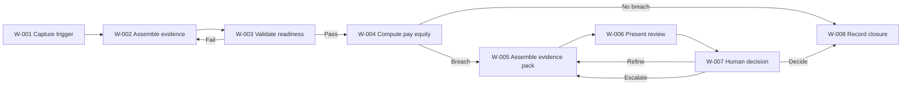

# Document Control and Version History

| Field | Value | Evidence |
| --- | --- | --- |
| Capability | Optimised Business Partnering | [SRC-01, section 3]; [SRC-06, section 6.3] |
| Business Agent | HR-PTO-002 Workforce-Intelligence Copilot | [SRC-06, section 6.3] |
| Value Stream | Measure to Reward | [SRC-06, section 3] |
| Methodology Authority | Stage 6 Design | [SRC-01, Stage 6 objective/inputs/actions/outputs] |
| Upstream input baseline | Stage 4 and Stage 5/5B outputs | [SRC-02]; [SRC-03] |
| ABBA source | Annotated_Agents_H2RList.csv | [SRC-04] |
| Prepared date | 2026-10-16 | This document |
| Status | Review-Ready (controlled gaps remain) | Sections 22-25 |

| Version | Date | Author | Change |
| --- | --- | --- | --- |
| 0.1 | 2026-10-16 | GitHub Copilot | Initial Stage 6 detailed design package |

# Executive Summary

This Stage 6 deliverable converts the approved logical architecture and approved end-to-end data model into a detailed, technology-agnostic design for all components in the Workforce-Intelligence Copilot workflow. It covers behaviour, deterministic logic, AI instructions, response design, exception handling, human interventions, controls, integrations, handovers, unit tests, ABBA reuse and Stage 6B readiness. [SRC-01, Stage 6 objective/actions/outputs]

Scope includes eight workflow steps and eight Stage 4 component agents, with explicit coverage of controls and handovers per step. [SRC-02, Workflow Decomposition Catalogue; SRC-02, Handover Register]

Overall status is Review-Ready with controlled gaps. The primary open areas are owner assignment finalisation, comparator-governance detail, and selected persistence/integration confirmations carried from Stage 5/5B. [SRC-02, Appendix D/F/H; SRC-03, Checks and ACO]

# Scope, Stage Boundary and Success Criteria

## Scope

- In-scope components: A-001 through A-008.
- In-scope workflow steps: W-001 through W-008.
- In-scope handovers: H-001 through H-007.
- In-scope controls: C-001 through C-008.

## Stage boundary

This document defines what each component does, what data it uses, what controls apply, and how quality is tested. It does not specify physical implementation architecture, deployment tooling, or platform-specific build details. [SRC-05, Stage boundary rules]

## Success criteria

- Detailed design for all components.
- Unit tests for normal and exception paths for each component.
- All controls and handovers designed and mapped.
- Ready for Stage 6B consolidation.

[SRC-01, Exit criteria]

# Source Inventory, Hierarchy and Evidence Map

| Source ID | Source | Role | Precedence |
| --- | --- | --- | --- |
| SRC-01 | Delivery-Control/Stage_6.md | Primary Stage 6/6B methodology authority | 1 |
| SRC-02 | Stage 4 Output/Workforce_Intelligence_Copilot_Stage_4_Classify.md | Agent, workflow, controls, handovers baseline | 4 |
| SRC-03 | Stage 5B Output/HR-PTO-002_Workforce_Intelligence_Copilot_Stage5B_Data_Model_Consolidation_v0.1.md | Approved data model baseline and consolidation checks | 5 |
| SRC-04 | ABBA-Reuse-Agents/Annotated_Agents_H2RList.csv | Reuse candidates and variance evidence | 6 |
| SRC-05 | Source Documents/Stage_6_document_generation.Instructions.md | Stage 6 governance and quality rules | 7 |
| SRC-06 | Source Documents/HR_Capability_and_Full_Agent_Catalogue_v1.md | Capability behaviour, deterministic rules, human boundary | 2 |
| SRC-07 | Source Documents/Stage_6_SKILL.md | Stage 6 procedural guidance and validation logic | 7 |

# Input Sufficiency Assessment

| Required input | Status | Notes | Evidence |
| --- | --- | --- | --- |
| Overall AI Framework | Available | Present in Stage 4 output and capability catalogue context | [SRC-02, Overall AI Framework] |
| Component AI Frameworks | Available | Agent-level framework entries present | [SRC-02, Appendix B] |
| Stage 4 classification/orchestration | Available | Full set of components, controls, handovers available | [SRC-02] |
| Approved Stage 5B data model | Available with controlled gaps | Approved for working review; residual pending checks noted | [SRC-03, state and checks] |
| Control points | Available | C-001 to C-008 defined | [SRC-02, Workflow Decomposition Catalogue] |
| ABBA reuse assessment | Available | Candidate-level decisions recorded | [SRC-02, Appendix C]; [SRC-04] |
| Business rules/constraints | Available with controlled gaps | Deterministic formula and constraints present; some thresholds/ownership pending | [SRC-06, deterministic requirements; SRC-03, ACO] |
| SME-confirmed workflow | Partial | Review-ready baseline exists; formal SME approval evidence pending | [SRC-02, SME Validation and Confirmation] |

# Framework, Classification and Internal Orchestration Review

## Component and classification baseline

| Component | Classifications | Workflow coverage | Evidence |
| --- | --- | --- | --- |
| A-001 Trigger and Context Capture Agent | Task, Experience | W-001 | [SRC-02, Appendix A] |
| A-002 Workforce Evidence Assembly Agent | Task, Insight | W-002 | [SRC-02, Appendix A] |
| A-003 Input Readiness and Comparison Control Agent | Control, Task | W-003 | [SRC-02, Appendix A] |
| A-004 Pay Equity Computation Agent | Task, Insight | W-004 | [SRC-02, Appendix A] |
| A-005 Evidence Pack Assembly Agent | Insight, Task | W-005 | [SRC-02, Appendix A] |
| A-006 Workforce Intelligence Orchestrator Agent | Orchestration, Control | W-001 to W-008 | [SRC-02, Appendix A] |
| A-007 Human Review and Decision Experience Agent | Experience, Orchestration | W-006/W-007 | [SRC-02, Appendix A] |
| A-008 Rationale and Approval Trail Control Agent | Control, Task | W-008 | [SRC-02, Appendix A] |

## Orchestration consistency check

Stage 4 sequence and decision loops are preserved in Stage 6 design, including comparator-validation loopbacks, refinement loops, escalation paths, and closure checks. [SRC-02, End-to-End Workflow Diagram]

# Purpose, Triggers, Objectives and User Stories

## Capability-level design objective

Design the full advisory lifecycle from reward review trigger to auditable closure while ensuring deterministic pay-equity analytics, explicit human decision authority, and complete control evidence. [SRC-06, section 3]

## User stories

| Story ID | User story | Evidence |
| --- | --- | --- |
| US-001 | As a Reward and HRBP user, I need deterministic pay-equity analysis so that advisory outputs are evidence-based and defensible. | [SRC-06, deterministic requirements] |
| US-002 | As a business leader, I need cited evidence packs so that I can make accountable workforce decisions. | [SRC-06, purpose/use case] |
| US-003 | As a control owner, I need a complete rationale and approval trail so that governance and audit checks can be satisfied. | [SRC-06, governance controls]; [SRC-06, audit trail schema] |
| US-004 | As a reviewer, I need clear escalation paths for sensitive or low-confidence cases so that risks are handled by the right humans. | [SRC-06, human-in-the-loop boundary]; [SRC-02, E-003/HIP-003] |

# End-to-End Workflow and Component Inventory

Evidence: [SRC-02, End-to-End Workflow Diagram]

# Detailed Component Behaviour Specifications

## CMP-001 (A-001) Trigger and Context Capture Agent

- Purpose: register trigger and decision context.
- Trigger: reward review event or leader question.
- Inputs: leader_question_context, reward_review_trigger.
- Outputs: workforce_decision_case.
- Behaviour: validate minimum context fields; create case and route to A-002 via A-006.
- Exceptions: missing context data -> E-001.
- Human boundary: trigger is human-initiated.

Evidence: [SRC-02, W-001]; [SRC-06, generic script]

## CMP-002 (A-002) Workforce Evidence Assembly Agent

- Purpose: assemble governed input package.
- Inputs: workforce_plan, scenario, people_analytics, labour_cost, policy_guidance.
- Outputs: governed_evidence_bundle, source_data_snapshot.
- Behaviour: collect and normalise data; attach provenance references.
- Control interaction: passes bundle to readiness controls.

Evidence: [SRC-02, W-002]; [SRC-03, E-005]

## CMP-003 (A-003) Input Readiness and Comparison Control Agent

- Purpose: validate completeness/provenance/comparator method.
- Inputs: governed_evidence_bundle, comparison_group_definition.
- Outputs: readiness_status, comparator_validation_result.
- Behaviour: pass/hold/escalate decision (D-001).
- Exception paths: E-001 and E-002 with HIP-001.

Evidence: [SRC-02, W-003/D-001/E-001/E-002]

## CMP-004 (A-004) Pay Equity Computation Agent

- Purpose: execute deterministic pay-gap calculations.
- Inputs: validated comparator data, threshold config.
- Outputs: pay_equity_result, threshold_breach_flag.
- Deterministic rule: pay_gap_pct = (avg_group_a - avg_group_b)/avg_group_a.
- Decision: breach route to W-005; non-breach route to W-008.

Evidence: [SRC-06, deterministic requirements]; [SRC-02, W-004]

## CMP-005 (A-005) Evidence Pack Assembly Agent

- Purpose: produce cited evidence pack.
- Inputs: pay_equity_result, policy_context, decision_context.
- Outputs: evidence_pack, rationale_draft.
- Behaviour: deterministic evidence aggregation + grounded cited narrative.
- Control: citation completeness check.

Evidence: [SRC-02, W-005]; [SRC-06, tool catalogue]

## CMP-006 (A-006) Workforce Intelligence Orchestrator Agent

- Purpose: coordinate sequencing and routing.
- Inputs: step outcomes, decisions, control states.
- Outputs: handover payloads and route controls.
- Behaviour: enforce normal/exception loops and human checkpoints.

Evidence: [SRC-02, A-006 framework; SRC-02, workflow/handovers]

## CMP-007 (A-007) Human Review and Decision Experience Agent

- Purpose: present advisory output and capture human decisions.
- Inputs: evidence_pack, review context.
- Outputs: review state, decision_outcome_payload, escalation_instruction.
- Behaviour: support decide/refine/escalate paths while preserving recommendation vs approval separation.

Evidence: [SRC-02, W-006/W-007]; [SRC-06, human boundary]

## CMP-008 (A-008) Rationale and Approval Trail Control Agent

- Purpose: persist final rationale, approvals, and closure status.
- Inputs: decision outcome, no-breach outcome, evidence references.
- Outputs: approval_trail_record, case_status updates.
- Behaviour: closure completeness check (D-004), hold if missing metadata (E-005).

Evidence: [SRC-02, W-008/D-004/E-005]; [SRC-06, audit trail schema]

# Data Mapping and Stage 5B Alignment

| Map ID | Component | Direction | Data item | Stage 5B mapping | Status | Evidence |
| --- | --- | --- | --- | --- | --- | --- |
| MAP-001 | CMP-001 | Output | workforce_decision_case.case_id | E-004.case_id | Aligned | [SRC-03, E-004] |
| MAP-002 | CMP-002 | Output | governed_evidence_bundle.source_snapshot_id | E-005.source_snapshot_id | Aligned | [SRC-03, E-005] |
| MAP-003 | CMP-003 | Input | comparison_group_definition.comparator_set_id | E-003.comparator_set_id | Partial (TBC source) | [SRC-03, E-003; G-01] |
| MAP-004 | CMP-004 | Output | pay_equity_result.pay_gap_pct | E-007.pay_gap_pct | Aligned | [SRC-03, E-007] |
| MAP-005 | CMP-005 | Output | evidence_pack.evidence_pack_id | E-008.evidence_pack_id | Aligned | [SRC-03, E-008] |
| MAP-006 | CMP-007 | Output | human_decision_record.decision_id | E-009.decision_id | Aligned | [SRC-03, E-009] |
| MAP-007 | CMP-008 | Output | approval_trail_record.writeback_ref | E-010.writeback_ref | Partial (TBC destination) | [SRC-03, E-010; G-04] |

# Deterministic Logic Specifications

| Rule ID | Rule | Applies to | Inputs | Output | Evidence |
| --- | --- | --- | --- | --- | --- |
| BR-001 | pay_gap_pct=(avg_group_a-avg_group_b)/avg_group_a | CMP-004 | avg_group_a, avg_group_b | pay_gap_pct | [SRC-06, deterministic requirements] |
| BR-002 | breach if abs(gap)>threshold (default 5%) | CMP-004 | pay_gap_pct, threshold | threshold_breach_flag | [SRC-06, deterministic requirements] |
| BR-003 | closure requires rationale + approval trail metadata completeness | CMP-008 | human_decision_record, rationale fields, approval fields | closure or hold | [SRC-02, D-004/E-005] |

# AI Instructions and Prompts (where applicable)

| AI ID | Component | Purpose | Grounding requirements | Prohibited behaviour | Human boundary | Evidence |
| --- | --- | --- | --- | --- | --- | --- |
| AI-001 | CMP-005 | Generate cited rationale text in evidence_pack | Must cite source data and policy context from governed bundle | No unsupported numeric claims; no autonomous decision language | Advisory only, routed for human decision | [SRC-06, deterministic core/LLM boundary] |
| AI-002 | CMP-007 | Present and summarise advisory pack for human review | Must preserve provenance and confidence context | No approval implication or decision execution | Human decides/refines/escalates | [SRC-06, human boundary]; [SRC-02, W-007] |

# Response and Citation Designs

| Response ID | Trigger | Audience | Mandatory response fields | Citation requirement | Evidence |
| --- | --- | --- | --- | --- | --- |
| RSP-001 | Threshold breach detected | Reward + HRBP, business leader | gap_summary, impacted_groups, rationale_text, citations, recommended_human_actions | Every analytic claim must cite source bundle/policy | [SRC-02, W-005/W-006] |
| RSP-002 | No threshold breach | Reward + HRBP | no_breach_summary, confidence_note, closure_recommendation | Cite deterministic result and threshold config | [SRC-02, W-004/W-008] |
| RSP-003 | Escalation required | Human approvers | escalation_reason, risk_context, required_inputs | Cite low-confidence/sensitive trigger and supporting evidence | [SRC-02, E-003/HIP-003] |

# Exception Handling and Escalation Designs

| Exception ID | Trigger | Handling | Escalation | Resolution evidence |
| --- | --- | --- | --- | --- |
| EXC-001 (E-001) | Missing governed input | Controlled hold and remediation request | HIP-001 | Updated input completeness record |
| EXC-002 (E-002) | Comparator method not governed | Block compute, request methodology validation | HIP-001 | Comparator approval record |
| EXC-003 (E-003) | Sensitive/low-confidence case | Route to human-led escalation | HIP-003 | Escalation decision record |
| EXC-004 (E-004) | Human refinement request | Loop to W-005 with trace | HIP-002 | Revised evidence pack record |
| EXC-005 (E-005) | Missing rationale/approval metadata | Prevent closure, remediate evidence | Control owner (TBC) | Completed approval-trail record |

Evidence: [SRC-02, Exception Catalogue]

# Human Intervention and Approval Designs

| HIP ID | Role | Trigger | Required action | Output | Evidence |
| --- | --- | --- | --- | --- | --- |
| HIP-001 | Reward + HRBP | E-001/E-002 | Assess missing data or comparator controls and authorise path | Remediation direction | [SRC-02, HIP-001] |
| HIP-002 | Reward + HRBP and/or business leader | W-007 | Decide, refine, or escalate based on evidence pack | decision_outcome_payload | [SRC-02, HIP-002] |
| HIP-003 | Reward + HRBP and/or business leader | E-003 | Execute escalation handling for sensitive/low-confidence issues | escalation decision output | [SRC-02, HIP-003] |

# Control Operation and Audit Evidence

| Control ID | Step | Objective | Operation | Evidence produced | Owner | Evidence |
| --- | --- | --- | --- | --- | --- | --- |
| C-001 | W-001 | Validate intake completeness | Embedded context checks | case_context_completeness_flag | TBC | [SRC-02, W-001] |
| C-002 | W-002 | Ensure governed evidence assembly | Deterministic rule | provenance trace + source snapshot | TBC | [SRC-02, W-002] |
| C-003 | W-003 | Enforce readiness and comparator governance | Control agent checks | readiness_status + comparator result | TBC | [SRC-02, W-003] |
| C-004 | W-004 | Enforce deterministic compute boundary | Deterministic rule set | pay_equity_result | TBC | [SRC-06, deterministic requirements] |
| C-005 | W-005 | Ensure cited evidence quality | Embedded control | citation completeness flags | TBC | [SRC-02, W-005] |
| C-006 | W-006 | Ensure review boundary | Human review gate | review request evidence | TBC | [SRC-02, W-006] |
| C-007 | W-007 | Ensure human approval boundary | Human approval gate | decision record | TBC | [SRC-02, W-007] |
| C-008 | W-008 | Ensure auditable closure evidence | Audit check | approval_trail_record | TBC | [SRC-02, W-008] |

# Logical Integration Specifications

| Integration ID | Source | Destination | Payload | Trigger | Evidence |
| --- | --- | --- | --- | --- | --- |
| INT-001 | CMP-001 | CMP-002 | trigger_context_payload | Case initiation | [SRC-02, H-001] |
| INT-002 | CMP-002 | CMP-003 | evidence_bundle_payload | Evidence assembly complete | [SRC-02, H-002] |
| INT-003 | CMP-003 | CMP-004 | readiness_assessment_payload | Readiness pass | [SRC-02, H-003] |
| INT-004 | CMP-004 | CMP-005 | pay_equity_payload | Threshold breach | [SRC-02, H-004] |
| INT-005 | CMP-005 | CMP-007 | evidence_pack_payload | Evidence pack complete | [SRC-02, H-005] |
| INT-006 | CMP-007 | CMP-008 | decision_outcome_payload | Human decision complete | [SRC-02, H-006] |
| INT-007 | CMP-008 | Case store | finalisation_payload | Closure check pass | [SRC-02, H-007] |

# Workflow Handover Specifications

| Handover ID | Producer | Consumer | Payload | Shared key | Control linkage | Evidence |
| --- | --- | --- | --- | --- | --- | --- |
| H-001 | W-001 | W-002 | trigger context and metadata | case_id | C-001 | [SRC-02, H-001] |
| H-002 | W-002 | W-003 | governed evidence bundle | case_id, source_snapshot_id | C-002, C-003 | [SRC-02, H-002] |
| H-003 | W-003 | W-004 | readiness pass package | case_id, comparator_set_id | C-003 | [SRC-02, H-003] |
| H-004 | W-004 | W-005 | pay-equity breach package | case_id, pay_equity_result_id | C-004 | [SRC-02, H-004] |
| H-005 | W-005 | W-006 | evidence pack | case_id, evidence_pack_id | C-005 | [SRC-02, H-005] |
| H-006 | W-006/W-007 | W-008 | decision outcome and escalation notes | case_id, decision_id | C-006, C-007 | [SRC-02, H-006] |
| H-007 | W-008 | End-state store | closure and approval trail | case_id, approval_record_id | C-008 | [SRC-02, H-007] |

# ABBA Reuse Assessment

| ABBA ID | Candidate asset | Fit area | Reuse decision in Stage 6 design | Variance notes | Evidence |
| --- | --- | --- | --- | --- | --- |
| ABBA-001 (VA-1168) | Rewards strategy orchestrator | Orchestration | Adapted | Added explicit human-boundary and audit evidence requirements | [SRC-04, row VA-1168]; [SRC-02, Appendix C] |
| ABBA-002 (VA-1173) | Compensation workflow manager | Approval flow | Adapted | Added escalation and control checkpoints | [SRC-04, row VA-1173]; [SRC-02, Appendix C] |
| ABBA-003 (VA-1141) | Rewards compliance monitor | Control | Adapted | Extended to comparator governance and provenance controls | [SRC-04, row VA-1141]; [SRC-02, Appendix C] |
| ABBA-004 (VA-1134) | Compensation analyser | Insight | Adapted | Restricted to deterministic pay-equity logic boundary | [SRC-04, row VA-1134]; [SRC-06, deterministic core boundary] |
| ABBA-005 (VA-1253) | Payroll experience agent | Experience | New design required | Workforce-intelligence decision UX differs from payroll experience UX | [SRC-04, row VA-1253]; [SRC-02, Appendix C] |

# RACI Matrix

| Activity ID | Activity | R | A | C | I | Human approval required | Evidence |
| --- | --- | --- | --- | --- | --- | --- | --- |
| RAC-001 | Trigger capture and case creation | A-001 | Reward + HRBP (TBC split) | Business leader (TBC) | A-006 | Yes | [SRC-02, W-001/HIP-002] |
| RAC-002 | Evidence assembly | A-002 | Reward + HRBP (TBC split) | Data owner (TBC) | A-006 | No | [SRC-02, W-002] |
| RAC-003 | Readiness and comparator validation | A-003 | Reward + HRBP | Control owner (TBC) | A-006 | Yes on fail path | [SRC-02, W-003/HIP-001] |
| RAC-004 | Deterministic pay-equity compute | A-004 | Reward + HRBP (TBC) | A-003 | A-006 | No | [SRC-02, W-004] |
| RAC-005 | Evidence pack generation | A-005 | Reward + HRBP (TBC) | A-004 | A-007 | No | [SRC-02, W-005] |
| RAC-006 | Human review and decision | A-007 + human reviewers | Reward + HRBP and/or business leader (TBC split) | A-006 | A-008 | Yes | [SRC-02, W-007/HIP-002] |
| RAC-007 | Closure and audit trail persistence | A-008 | Control owner (TBC) | Reward + HRBP | Governance stakeholders | Yes | [SRC-02, W-008/D-004] |

# Unit-Test Scenarios and Expected Results

| Test ID | Component | Scenario type | Scenario | Expected result | Evidence |
| --- | --- | --- | --- | --- | --- |
| UT-001 | CMP-001 | Normal | Valid trigger and complete context | case_id created and routed to W-002 | [SRC-02, W-001] |
| UT-002 | CMP-001 | Exception | Missing mandatory context fields | E-001 raised; hold state set | [SRC-02, E-001] |
| UT-003 | CMP-002 | Normal | All required source inputs available | governed_evidence_bundle created with source snapshot | [SRC-02, W-002] |
| UT-004 | CMP-002 | Exception | Policy source unavailable | gap logged and route to remediation | [SRC-03, G-03] |
| UT-005 | CMP-003 | Normal | Complete inputs and valid comparator method | readiness_status=Pass and H-003 emitted | [SRC-02, D-001/H-003] |
| UT-006 | CMP-003 | Exception | Comparator method not governed | E-002 and HIP-001 escalation | [SRC-02, E-002/HIP-001] |
| UT-007 | CMP-004 | Normal | Pay gap below threshold | threshold_flag=No breach and handoff to W-008 | [SRC-02, D-002] |
| UT-008 | CMP-004 | Exception | Pay gap above threshold | threshold_flag=Breach and handoff to W-005 | [SRC-02, D-002/H-004] |
| UT-009 | CMP-005 | Normal | Valid breach result input | evidence_pack with citations produced | [SRC-02, W-005] |
| UT-010 | CMP-005 | Exception | Citation completeness check fails | controlled remediation before W-006 | [SRC-02, C-005] |
| UT-011 | CMP-007 | Normal | Human chooses decision | decision_outcome_payload emitted to W-008 | [SRC-02, W-007/H-006] |
| UT-012 | CMP-007 | Exception | Human requests refinement | E-004 loopback to W-005 | [SRC-02, E-004] |
| UT-013 | CMP-007 | Exception | Sensitive case | E-003 and HIP-003 path invoked | [SRC-02, E-003/HIP-003] |
| UT-014 | CMP-008 | Normal | Complete decision metadata | approval_trail_record stored and case closed | [SRC-02, D-004] |
| UT-015 | CMP-008 | Exception | Missing approval metadata | E-005 hold; no closure | [SRC-02, E-005] |

# Assumptions, Constraints, Open Questions, Risks, Gaps and Actions

| ID | Type | Statement | Severity | Action |
| --- | --- | --- | --- | --- |
| ASM-001 | Assumption | Stage 5B output is sufficient for Stage 6 detailed design progression | Major | Validate remaining pending checks in Stage 6B |
| CON-001 | Constraint | Ownership and stewardship remain partially unresolved | Major | Close ownership assignments before build-readiness |
| OQ-001 | Open question | Final split of approval authority between Reward + HRBP and business leaders | Major | Confirm in governance/RACI workshop |
| RSK-001 | Risk | Comparator governance gap may invalidate fairness/compliance outcomes | Critical | Finalise structured comparator model and approval controls |
| GAP-001 | Missing information | Destination system for approval trail persistence not confirmed | Major | Resolve G-04 carry-over and update INT/H specs |
| ACT-001 | Action | Conduct peer review across all component designs and control mappings | Major | Assign design lead and evidence review completion |

Evidence: [SRC-03, G-01/G-02/G-04/G-08]; [SRC-02, OQ register]

# Coverage Metrics and Quality-Gate Results

| Metric | Numerator | Denominator | % | Status |
| --- | --- | --- | --- | --- |
| Traceability coverage | 8 | 8 | 100% | Pass |
| Data model alignment | 5 | 7 | 71.4% | Fail |
| Human intervention coverage | 3 | 3 | 100% | Pass |
| Unit test coverage | 8 | 8 | 100% | Pass |
| ABBA reuse assessment coverage | 5 | 5 | 100% | Pass |
| Control coverage | 8 | 8 | 100% | Pass |
| Workflow handover coverage | 7 | 7 | 100% | Pass |
| RACI coverage | 7 | 7 | 100% | Pass |

Notes:

- Data model alignment fails due to unresolved mappings for comparator governance and approval-trail destination (MAP-003, MAP-007).

# Stage 6 Controls and Evidence Assessment

| Control and evidence item | Status | Evidence |
| --- | --- | --- |
| Design peer review | Pending - evidence required | ACT-001 |
| Unit test coverage review | Pass (design scenario completeness) | UT-001 to UT-015 |
| Control point validation | Pass | C-001 to C-008 map |
| SME visibility | Partial | Stage 4 review-ready evidence present; Stage 6 SME review evidence pending |
| ABBA reuse evidence | Pass | ABBA-001 to ABBA-005 |
| Assumption and risk log | Pass | ASM/CON/OQ/RSK/GAP entries |

# Exit Criteria and Stage 6B Readiness Assessment

| Stage 6 exit criterion | Status | Evidence |
| --- | --- | --- |
| All components have detailed designs | Pass | CMP-001 to CMP-008 sections |
| Unit tests defined for every component | Pass | UT-001 to UT-015 |
| All controls and handovers designed | Pass | C-001 to C-008; H-001 to H-007 |
| Ready for Stage 6B consolidation | Ready with controlled gaps | Data mapping gaps and ownership questions remain, but consolidation can proceed with explicit issue log |

Stage 6B recommendation: Ready with controlled gaps.

Rationale:

- Structural and behavioural coverage is complete.
- Control and handover design coverage is complete.
- Critical business boundary (human-led decisions) is preserved.
- Remaining gaps are explicitly identified and governable through consolidation issue/action tracking.

# Appendices and Traceability Matrices

## Appendix A - Component-to-Workflow Traceability

| Component | Workflow step(s) | Control(s) | Handover(s) | Tests |
| --- | --- | --- | --- | --- |
| CMP-001 | W-001 | C-001 | H-001 | UT-001, UT-002 |
| CMP-002 | W-002 | C-002 | H-002 | UT-003, UT-004 |
| CMP-003 | W-003 | C-003 | H-003 | UT-005, UT-006 |
| CMP-004 | W-004 | C-004 | H-004/H-007 | UT-007, UT-008 |
| CMP-005 | W-005 | C-005 | H-005 | UT-009, UT-010 |
| CMP-006 | W-001 to W-008 | C-001..C-008 | H-001..H-007 | Covered via component interactions |
| CMP-007 | W-006/W-007 | C-006/C-007 | H-006 | UT-011, UT-012, UT-013 |
| CMP-008 | W-008 | C-008 | H-007 | UT-014, UT-015 |

## Appendix B - Source References

- [SRC-01] Delivery-Control/Stage_6.md  
- [SRC-02] Stage 4 Output/Workforce_Intelligence_Copilot_Stage_4_Classify.md  
- [SRC-03] Stage 5B Output/HR-PTO-002_Workforce_Intelligence_Copilot_Stage5B_Data_Model_Consolidation_v0.1.md  
- [SRC-04] ABBA-Reuse-Agents/Annotated_Agents_H2RList.csv  
- [SRC-05] Source Documents/Stage_6_document_generation.Instructions.md  
- [SRC-06] Source Documents/HR_Capability_and_Full_Agent_Catalogue_v1.md  
- [SRC-07] Source Documents/Stage_6_SKILL.md
