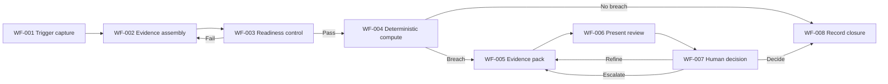

# Document Control

| Field | Value | Evidence |
| --- | --- | --- |
| Capability | Optimised Business Partnering | [SRC-01, section 6.3] |
| Capability ID | HR-PTO-002 | [SRC-01, section 6.3] |
| Stage 6 baseline | HR-PTO-002_Workforce_Intelligence_Copilot_Stage_6_Detailed_Design_v0.1.md | [SRC-03] |
| Stage 6B objective | Consolidate component designs into coherent end-to-end solution and assess build readiness | [SRC-02, Stage 6B objective/actions/outputs] |
| Design Authority body | Factory Design Authority (including SME) | [SRC-02, Design Authority approval] |
| Validation status | Completed with open consolidation actions | Sections 13 and 14 |

# Contents

1. Executive Summary  
2. Stage 6B Objective and Scope  
3. Source Inventory and Evidence Map  
4. Consolidated Solution Design  
5. End-to-End Orchestration Assurance  
6. Consolidated Control Coverage  
7. Unit-Test Coverage Assessment  
8. Readiness Assessment  
9. Consolidated Issues, Risks and Actions Log  
10. Recommended Implementation Technology  
11. Controls, Evidence and Exit Criteria  
12. Assumptions, Dependencies and Limitations  
13. Appendices

# Executive Summary

This Stage 6B deliverable consolidates the Stage 6 component designs for Workforce-Intelligence Copilot and validates coherence across workflow sequence, data exchange, controls, handovers, exception handling, human intervention and test coverage. [SRC-02, Stage 6B actions 1-11]

Consolidation outcome:

- All eight components assembled into one end-to-end design view.
- Workflow and handover continuity validated across W-001 to W-008 and H-001 to H-007.
- Control coverage map confirms control presence across all workflow steps.
- Unit-test coverage confirms normal and exception scenario design coverage for all components.
- Readiness remains conditional on closure of a limited set of governance/data alignment actions.

Overall status: Review-Ready, Not Build Ready pending closure of blocking CIA items.

# Stage 6B Objective and Scope

## Objective

Bring all Stage 6 component designs together and confirm the complete solution is coherent, controlled, testable and aligned to business outcomes. [SRC-02, Stage 6B objective]

## Scope

In-scope:

- Consolidation of component designs CMP-001 to CMP-008.
- Validation of end-to-end flow, controls, handovers, exceptions, human interventions, and unit-test sufficiency.
- Build-readiness recommendation for Design Authority review.

Out-of-scope:

- Re-authoring Stage 6 component designs.
- Physical implementation design/build/deployment.
- Stage 7 build execution.

# Source Inventory and Evidence Map

| Source ID | Source | Purpose | Precedence |
| --- | --- | --- | --- |
| SRC-01 | Source Documents/HR_Capability_and_Full_Agent_Catalogue_v1.md | Capability purpose, deterministic and governance baseline | 2 |
| SRC-02 | Delivery-Control/Stage_6.md | Authoritative Stage 6B methodology requirements | 1 |
| SRC-03 | Stage 6 Output/HR-PTO-002_Workforce_Intelligence_Copilot_Stage_6_Detailed_Design_v0.1.md | Primary consolidation input | 2 |
| SRC-04 | Stage 4 Output/Workforce_Intelligence_Copilot_Stage_4_Classify.md | Workflow, controls and handover baseline | 4 |
| SRC-05 | Stage 5B Output/HR-PTO-002_Workforce_Intelligence_Copilot_Stage5B_Data_Model_Consolidation_v0.1.md | Approved data model and open data-governance items | 5 |
| SRC-06 | ABBA-Reuse-Agents/Annotated_Agents_H2RList.csv | Reuse traceability and variance support | 6 |
| SRC-07 | Source Documents/stage-6b-document-generation.instructions.md | Stage 6B governance constraints and quality gates | 7 |
| SRC-08 | Source Documents/stage-6b-SKILL.md | Stage 6B procedural/validation guidance | 7 |

# Consolidated Solution Design

## Component consolidation matrix

| Component ID | Component name | Stage 6 status | Consolidation status | Key dependency | Evidence |
| --- | --- | --- | --- | --- | --- |
| CMP-001 | Trigger and Context Capture | Designed | Consolidated | Input context quality | [SRC-03, CMP-001] |
| CMP-002 | Workforce Evidence Assembly | Designed | Consolidated | Source-system data quality | [SRC-03, CMP-002] |
| CMP-003 | Input Readiness and Comparison Control | Designed | Consolidated with issues | Comparator governance definition | [SRC-03, CMP-003]; [SRC-05, G-01] |
| CMP-004 | Pay Equity Computation | Designed | Consolidated | Deterministic rule completeness | [SRC-03, CMP-004/BR-001/BR-002] |
| CMP-005 | Evidence Pack Assembly | Designed | Consolidated | Citation quality | [SRC-03, CMP-005/AI-001] |
| CMP-006 | Workforce Intelligence Orchestrator | Designed | Consolidated | Consistent routing and loop controls | [SRC-03, CMP-006] |
| CMP-007 | Human Review and Decision Experience | Designed | Consolidated with issues | Approval-role split and escalation criteria | [SRC-03, CMP-007]; [SRC-05, G-02/G-07] |
| CMP-008 | Rationale and Approval Trail Control | Designed | Consolidated with issues | Final persistence destination and owner | [SRC-03, CMP-008]; [SRC-05, G-04] |

## Consolidated behavioural view

The component chain and decision loops are coherent and preserve governance boundaries: deterministic analytics remain in CMP-004, narrative assembly in CMP-005, human decisions in CMP-007, and closure evidence in CMP-008. [SRC-03, sections 9-16]

# End-to-End Orchestration Assurance

Evidence: [SRC-03, workflow diagram]

## Handover coherence check

| Handover | Source/target continuity | Payload continuity | Consolidation result | Evidence |
| --- | --- | --- | --- | --- |
| H-001 | Valid | Valid | Pass | [SRC-04, H-001]; [SRC-03, H-001] |
| H-002 | Valid | Valid | Pass | [SRC-04, H-002]; [SRC-03, H-002] |
| H-003 | Valid | Partial (comparator governance detail pending) | Partial | [SRC-03, MAP-003]; [SRC-05, G-01] |
| H-004 | Valid | Valid | Pass | [SRC-04, H-004]; [SRC-03, H-004] |
| H-005 | Valid | Valid | Pass | [SRC-04, H-005]; [SRC-03, H-005] |
| H-006 | Valid | Valid | Pass | [SRC-04, H-006]; [SRC-03, H-006] |
| H-007 | Valid | Partial (final store destination unresolved) | Partial | [SRC-03, MAP-007]; [SRC-05, G-04] |

# Consolidated Control Coverage

| Workflow step | Controls | Coverage result | Notes | Evidence |
| --- | --- | --- | --- | --- |
| WF-001 | C-001 | Pass | Intake completeness control present | [SRC-03, control matrix] |
| WF-002 | C-002 | Pass | Provenance and source trace control present | [SRC-03, control matrix] |
| WF-003 | C-003 | Pass | Readiness and comparator gate defined | [SRC-03, control matrix] |
| WF-004 | C-004 | Pass | Deterministic rule enforcement defined | [SRC-03, BR section] |
| WF-005 | C-005 | Pass | Citation quality control defined | [SRC-03, control matrix] |
| WF-006 | C-006 | Pass | Human review gate defined | [SRC-03, control matrix] |
| WF-007 | C-007 | Pass | Human approval boundary defined | [SRC-03, control matrix] |
| WF-008 | C-008 | Partial | Closure control present; destination ownership unresolved | [SRC-03, control matrix]; [SRC-05, G-04] |

Control coverage summary: 8/8 steps controlled, with one partial control-evidence destination issue.

# Unit-Test Coverage Assessment

| Coverage domain | Population | Covered | % | Status | Evidence |
| --- | --- | --- | --- | --- | --- |
| Components with normal tests | 8 | 8 | 100% | Pass | [SRC-03, UT register] |
| Components with exception tests | 8 | 8 | 100% | Pass | [SRC-03, UT register] |
| Handovers referenced by tests | 7 | 7 | 100% | Pass | [SRC-03, UT vs H trace] |
| Controls referenced by tests | 8 | 8 | 100% | Pass | [SRC-03, UT/control mapping] |
| HIP paths referenced by tests | 3 | 3 | 100% | Pass | [SRC-03, UT-006/012/013] |

# Readiness Assessment

## Alignment with Overall AI Framework and business outcome

Alignment is evidenced for advisory-only design stance, deterministic calculation boundary, human-led decision authority, and closure evidence controls. [SRC-01, section 3 and 4.4]; [SRC-03, sections 11-16]

## Build-readiness decision

| Criterion | Status | Evidence |
| --- | --- | --- |
| All component designs consolidated | Pass | Component matrix |
| End-to-end flow coherent | Pass | Orchestration assurance |
| Inputs/outputs and handovers fully validated | Partial | H-003 and H-007 unresolved attributes |
| Control coverage complete | Partial | C-008 destination evidence gap |
| Unit-test coverage sufficient | Pass | Unit-test coverage assessment |
| Design Authority approval evidenced | Pending | No DA approval record yet |

Readiness result: Not Build Ready until blocking CIA items close.

# Consolidated Issues, Risks and Actions Log

| CIA ID | Type | Severity | Blocking | Description | Impacted area | Action | Owner | Evidence |
| --- | --- | --- | --- | --- | --- | --- | --- | --- |
| CIA-01 | Gap | Critical | Yes | Comparator governance data structure unresolved (comparator_set_id governance model not finalised) | CMP-003, H-003, BR alignment | Define and approve comparator governance entity and attributes | Reward + HRBP (TBC) | [SRC-05, G-01] |
| CIA-02 | Gap | Critical | Yes | Approval trail persistence destination and owner unresolved | CMP-008, H-007, C-008 | Confirm destination system, ownership and retention evidence | Tech owner (TBC) | [SRC-05, G-04] |
| CIA-03 | Open question | Major | No | Human approval-role split unresolved between Reward+HRBP and business leader contexts | CMP-007, RACI | Confirm role split and update RACI/control owner fields | Capability owner (TBC) | [SRC-05, G-02]; [SRC-03, RACI] |
| CIA-04 | Gap | Major | No | Sensitivity/low-confidence trigger attributes not formally defined | EXC-003 path | Define threshold and trigger attributes | Reward + HRBP (TBC) | [SRC-05, G-07] |
| CIA-05 | Evidence | Major | No | Stage 6 peer review evidence not yet recorded | Governance controls | Execute and record design peer review | Design lead (TBC) | [SRC-03, controls and evidence assessment] |
| CIA-06 | Evidence | Major | No | Design Authority approval pending | Approval gate | Conduct DA review and record outcome as DEC-001 | DA body | [SRC-02, approval gate] |

# Recommended Implementation Technology

This section provides consolidation-stage recommendation only (not implementation specification).

## Recommendation

Adopt a modular enterprise AI workflow stack that supports deterministic rule services, governed data access, controlled prompt orchestration, and auditable decision/event logging.

## Rationale

- Deterministic computation and control-gate separation are mandatory.
- Human approval workflow and audit trail evidencing are central.
- Data lineage and governance controls require first-class support.

## Option-level criteria

- Ability to enforce deterministic logic independently of LLM behaviour.
- Native support for auditable event logging and approval workflows.
- Strong role/permission modelling for human intervention points.
- Integration support for governed enterprise data sources.

Evidence: [SRC-01, Stage 6 practitioner guidance]; [SRC-06, deterministic boundary/governance controls]

# Controls, Evidence and Exit Criteria

| Stage 6B control/evidence item | Status | Evidence |
| --- | --- | --- |
| Consolidation review by design lead | Pending | CIA-05 |
| SME visibility | Partial | Stage 4/5 review baselines exist; Stage 6B-specific review evidence pending |
| Design Authority review and approval | Pending | CIA-06 |
| Evidence of alignment to business outcome | Pass | Readiness assessment alignment section |

| Stage 6B exit criterion | Status | Evidence |
| --- | --- | --- |
| All items resolved | Fail | CIA-01 and CIA-02 open/blocking |
| Design Authority approval | Pending | CIA-06 |
| Build ready confirmed | Fail | Blocking CIA items open |

# Assumptions, Dependencies and Limitations

| ID | Type | Statement | Status | Evidence |
| --- | --- | --- | --- | --- |
| ASM-01 | Assumption | Current Stage 6 draft is the full component-design baseline for consolidation | Accepted with controls | [SRC-03] |
| DEP-01 | Dependency | Comparator-governance source artefact approval | Open | [SRC-05, G-01] |
| DEP-02 | Dependency | Persistence target and ownership confirmation for approval trail records | Open | [SRC-05, G-04] |
| LIM-01 | Limitation | Design Authority decision evidence not yet supplied | Open | [SRC-02, approval gate] |

# Appendices

## Appendix A - Consolidated counts

| Measure | Count |
| --- | --- |
| Components consolidated | 8 |
| Workflow steps | 8 |
| Handovers | 7 |
| Controls | 8 |
| Human intervention points | 3 |
| Unit tests mapped | 15 |
| CIA items | 6 |
| Blocking CIA items | 2 |

## Appendix B - Evidence references

- [SRC-01] Source Documents/HR_Capability_and_Full_Agent_Catalogue_v1.md  
- [SRC-02] Delivery-Control/Stage_6.md  
- [SRC-03] Stage 6 Output/HR-PTO-002_Workforce_Intelligence_Copilot_Stage_6_Detailed_Design_v0.1.md  
- [SRC-04] Stage 4 Output/Workforce_Intelligence_Copilot_Stage_4_Classify.md  
- [SRC-05] Stage 5B Output/HR-PTO-002_Workforce_Intelligence_Copilot_Stage5B_Data_Model_Consolidation_v0.1.md  
- [SRC-06] ABBA-Reuse-Agents/Annotated_Agents_H2RList.csv  
- [SRC-07] Source Documents/stage-6b-document-generation.instructions.md  
- [SRC-08] Source Documents/stage-6b-SKILL.md
